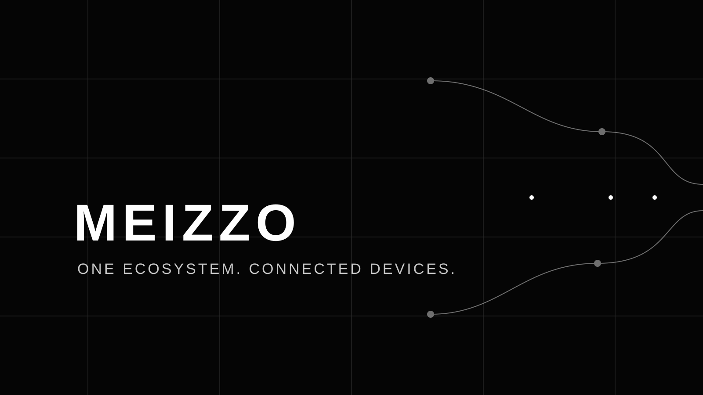

# COMMUNITY CODE OF CONDUCT

**Respectful collaboration. Clear communication. Shared responsibility.**

MEIZZO is a privacy- and security-sensitive project. A healthy community is part of its security model: people should be able to question decisions, report problems, and contribute without being targeted or exposed.

## At a glance

| We expect | We do not accept |
|---|---|
| Respectful, evidence-led discussion | Harassment, discrimination, or intimidation |
| Constructive technical disagreement | Personal attacks or targeted humiliation |
| Privacy-aware collaboration | Doxxing or disclosure of private information |
| Honest engineering and test reports | Deliberate misrepresentation of security or functionality |

## 1. Our commitment

MEIZZO welcomes contributors and community members regardless of experience, identity, background, or point of view.

We are committed to making project spaces useful, welcoming, accessible, and safe. Everyone participating in issues, pull requests, reviews, discussions, or other spaces representing MEIZZO is expected to act in good faith.

## 2. Expected behavior

Contribute to an environment where people can do their best work.

- **Be considerate.** Respect different experience levels, communication styles, and perspectives.
- **Be constructive.** Critique code, decisions, and ideas rather than a person's identity or worth.
- **Be evidence-led.** Explain technical disagreement with reproducible details and clear reasoning.
- **Be receptive.** Accept feedback professionally and keep review discussions focused.
- **Protect privacy.** Respect consent, user data, credentials, pairing codes, and private infrastructure details.
- **Give credit.** Acknowledge original work, references, and third-party contributions.
- **Make room for others.** Help newcomers understand project conventions without condescension.
- **Represent the project honestly.** Distinguish verified behavior from assumptions, planned work, and untested claims.

## 3. Unacceptable behavior

The following behavior is not acceptable:

- Harassment, discrimination, hate speech, threats, or intimidation.
- Sexualized language, unwanted advances, or persistent unwanted contact.
- Doxxing, stalking, or publishing someone's private information.
- Publishing passwords, access tokens, pairing codes, signing material, private endpoints, or user data.
- Deliberately disrupting project infrastructure, reviews, or community discussions.
- Personal attacks, repeated bad-faith arguments, or targeted humiliation.
- Impersonation or deceptive attribution.
- Deliberately falsifying test results, security claims, or product capabilities in ways that could put users or contributors at risk.
- Encouraging or coordinating activity that violates the project's security and consent principles.

## 4. Scope

This Code applies to:

- GitHub issues and discussions.
- Pull requests, code reviews, and commit conversations.
- Project documentation and community spaces.
- Events or communication channels where someone is representing MEIZZO.
- Public interactions where an individual's conduct materially affects the safety of the project community.

It applies equally to maintainers, contributors, reviewers, and visitors.

## 5. Maintainer responsibilities

Project maintainers are responsible for clarifying and enforcing these standards.

Depending on the circumstances, maintainers may:

- Remove or edit content that exposes people or sensitive information.
- Close or limit discussions that become abusive or unsafe.
- Request that a participant stop specific behavior.
- Restrict participation or take other proportionate action.
- Escalate serious concerns through appropriate platform channels.

Maintainers should explain enforcement decisions where doing so does not compromise privacy, security, or the safety of people involved.

## 6. Reporting a concern

For a conduct concern, contact the repository maintainers privately through GitHub. Do not publish personal details, private messages, or sensitive evidence in a public issue.

For a security vulnerability, follow the separate [Security Policy](SECURITY.md). Do not use a public conduct report to disclose an exploitable vulnerability.

Reports will be handled as confidentially as practical. The project will not publicly identify a reporter without permission, except where disclosure is required by law or necessary to address an imminent safety risk.

## 7. Resolution

Maintainers will review the report, gather relevant context, and determine a response that is fair and proportionate.

People asked to stop unacceptable behavior are expected to comply immediately. Retaliation against someone who raises a concern in good faith is not acceptable.

## 8. Attribution

This policy is informed by the [Contributor Covenant](https://www.contributor-covenant.org/) community Code of Conduct model and adapted for MEIZZO's privacy- and security-sensitive development context.

---

**MEIZZO COMMUNITY** · Build with respect.

[Contributing](CONTRIBUTING.md) · [Security](SECURITY.md)

