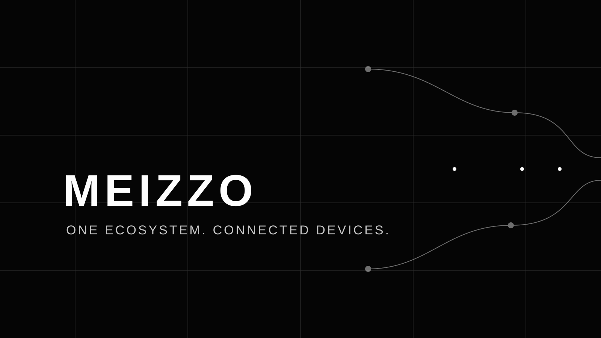

<div align="center">



# CONTRIBUTOR HANDBOOK

**Good engineering is collaborative, testable, and respectful of user trust.**

[Code of Conduct](CODE_OF_CONDUCT.md) · [Security Policy](SECURITY.md) · [Architecture](docs/architecture.md) · [Development Setup](docs/development.md)

</div>

Thank you for considering a contribution to MEIZZO.

MEIZZO is a beta device-assistance ecosystem with separate Client and Controller applications, a signaling service, and platform-specific implementations. Contributions should improve the product without weakening explicit consent, authenticated sessions, device isolation, or honest platform capability reporting.

> **Before you start:** read the [Code of Conduct](CODE_OF_CONDUCT.md), [Security Policy](SECURITY.md), [architecture guide](docs/architecture.md), and [implementation status](docs/implementation-status.md).

## Contribution paths

| Area | Useful contributions |
|---|---|
| Android | Client and Controller behavior, UI, permissions, reliability, tests |
| iOS | SwiftUI flows, supported platform capabilities, Simulator validation |
| Backend | Pairing, authentication, presence, telemetry, routing, resilience |
| Security | Threat review, authorization tests, dependency and secret hygiene |
| Quality | Reproducible bug reports, regression tests, accessibility |
| Documentation | Setup guides, API references, troubleshooting, diagrams |
| Delivery | CI reliability, reproducible builds, release validation |

For substantial features or architectural changes, open an issue first so scope, compatibility, and security implications can be discussed before implementation.

## 1. Engineering principles

### Consent and authorization

- A pairing code is temporary discovery, not authorization.
- The Client must explicitly approve each new pairing relationship.
- Never bypass Android or iOS permission prompts.
- Never hide active screen-sharing, camera, location, or other sensitive-session indicators.
- Revocation must invalidate the relevant authorization.
- A Controller must never access a Client outside its authenticated relationship.

### Platform honesty

- Do not claim iOS capabilities that public iOS APIs do not provide.
- Distinguish compilation, automated tests, Simulator smoke tests, emulator tests, and physical-device runtime tests.
- An unavailable telemetry value must remain unavailable, not be fabricated as zero.
- A visible button or placeholder screen does not make a feature implemented.
- Document platform-specific restrictions where they affect behavior.

### Privacy and secure development

- Never commit tokens, pairing codes, passwords, signing keys, provisioning profiles, private endpoints, or real user data.
- Keep secrets out of logs, screenshots, fixtures, test output, and issue descriptions.
- Production signaling must use TLS/WSS with normal certificate validation.
- Do not disable certificate validation or broaden cleartext exceptions to hide connectivity failures.
- Collect only the data required for the feature and its stated purpose.

### Maintainability

- Prefer focused changes over unrelated rewrites.
- Keep Client and Controller responsibilities distinct.
- Reuse established architecture and dependencies where appropriate.
- Add tests for behavior, not merely implementation details.
- Update documentation when behavior, setup, permissions, or limitations change.

## 2. Repository map

| Path | Responsibility |
|---|---|
| `apps/client` | Android Client |
| `apps/controller` | Android Controller |
| `ios/Client`, `ios/Controller` | Native iOS app targets |
| `ios/Shared` | Shared iOS networking and secure storage |
| `services/signaling` | Node.js WebSocket signaling backend |
| `docs` | User, developer, platform, operations, and security guides |
| `.github/workflows` | CI, Simulator, device-signing, release, and docs workflows |

## 3. Development environment

Use the versions documented by the repository and CI. The current baseline includes:

| Tool | Expected baseline |
|---|---|
| JDK | 17 |
| Android SDK | Platform 35 |
| Android Build Tools | 35.0.0 |
| Node.js | 22 |
| Package manager | npm |
| iOS toolchain | Xcode on macOS |
| Project generation | XcodeGen, where required |

Follow the platform setup guides for full installation details:

- [Development setup](docs/development.md)
- [Android guide](docs/android-guide.md)
- [iOS guide](docs/ios-guide.md)
- [BlueStacks Air guide](docs/bluestacks-air.md)

## 4. Run the relevant checks

Run checks for every area changed. Do not report a check as passed unless it completed successfully.

### Signaling backend

```bash
cd services/signaling
npm ci
npm run check
npm test
```

### Android Client and Controller

From the repository root:

```bash
./gradlew :apps:client:assembleDebug
./gradlew :apps:controller:assembleDebug
```

For BlueStacks Air, configure the Mac's reachable LAN endpoint explicitly:

```bash
./gradlew \
  -Pmeizzo.debugSignalingUrl=ws://192.168.1.20:8080 \
  :apps:client:assembleDebug :apps:controller:assembleDebug
```

Replace the example address with the actual host address. Do not assume that `10.0.2.2` is reachable from every emulator environment. See [BlueStacks Air setup](docs/bluestacks-air.md).

### iOS

When changing iOS targets, run the iOS Simulator workflow and the repository's Simulator smoke script on macOS:

```bash
ios/scripts/simulator-smoke.sh
```

A successful Simulator launch does not prove physical-device signing, provisioning, or end-to-end network behavior.

### Documentation

Install the dependencies listed in `requirements-docs.txt`, then run the strict MkDocs build used by CI:

```bash
python -m pip install -r requirements-docs.txt
mkdocs build --strict
```

Resolve broken internal links and warnings before submitting.

## 5. Branch and commit conventions

Create a focused branch from the latest `main` branch.

Suggested names:

- `feat/controller-device-details`
- `fix/android-network-policy`
- `test/presence-reconnect`
- `docs/bluestacks-air-guide`
- `ci/release-validation`

Use concise conventional commit prefixes:

| Prefix | Use |
|---|---|
| `feat:` | New functionality |
| `fix:` | Bug fix |
| `docs:` | Documentation |
| `test:` | Tests and test infrastructure |
| `refactor:` | Internal restructuring without intended behavior change |
| `ci:` | Continuous integration and delivery |
| `build:` | Build system and dependency configuration |

Avoid unrelated formatting changes, generated build outputs, and broad file churn in functional pull requests.

## 6. Pull request standard

A pull request should make the change understandable and independently reviewable.

Include:

1. **Problem:** what user or developer problem is being solved?
2. **Approach:** what changed and why was this implementation chosen?
3. **Scope:** which apps, services, workflows, or documentation are affected?
4. **Behavior:** what changes for Client and Controller?
5. **Security:** does the change affect consent, identity, tokens, permissions, transport, or session isolation?
6. **Compatibility:** are package IDs, bundle IDs, stored credentials, and update-signing compatibility preserved?
7. **Validation:** list exact commands, workflow links, and actual results.
8. **Limitations:** identify tests not run, hardware not available, and unsupported capabilities.
9. **Visual evidence:** include before/after screenshots for UI changes, with private information removed.

### Pull request checklist

- [ ] The change has a focused scope and a clear rationale.
- [ ] Client and Controller responsibilities remain distinct.
- [ ] Consent, authentication, revocation, and session isolation are preserved.
- [ ] Relevant tests were added or updated.
- [ ] Android and iOS limitations are accurately documented.
- [ ] Documentation and navigation links are updated.
- [ ] No secrets, personal data, or generated build outputs were committed.
- [ ] Build and test evidence is reported without exaggeration.
- [ ] User-visible changes include appropriate screenshots or a clear explanation if screenshots are unavailable.

## 7. Review and merge

Maintainers may request changes when a pull request:

- Lacks reproducible validation evidence.
- Weakens security or consent boundaries.
- Introduces unverified platform claims.
- Breaks Client/Controller compatibility.
- Adds unnecessary dependencies or unrelated changes.
- Leaves documentation inconsistent with the implementation.

Keep review discussion respectful and technical. Resolve review threads with a clear explanation or a corresponding code change.

## 8. License and contribution rights

No root-level project license has been finalized. Public repository visibility does not, by itself, grant permission to reuse, modify, or redistribute the source. The repository owner must select and add a license before MEIZZO can claim a specific open-source license.

By submitting a contribution, you confirm that you have the right to submit it and that you are not knowingly including third-party material without the necessary rights. This statement does not replace a future formal contributor license agreement.

---

<div align="center">

**THANK YOU FOR BUILDING MEIZZO.**

[Community Code of Conduct](CODE_OF_CONDUCT.md) · [Security reporting](SECURITY.md) · [Project documentation](docs/index.md)

</div>
