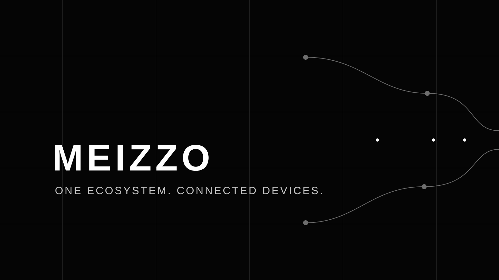
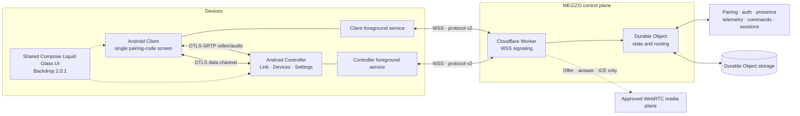
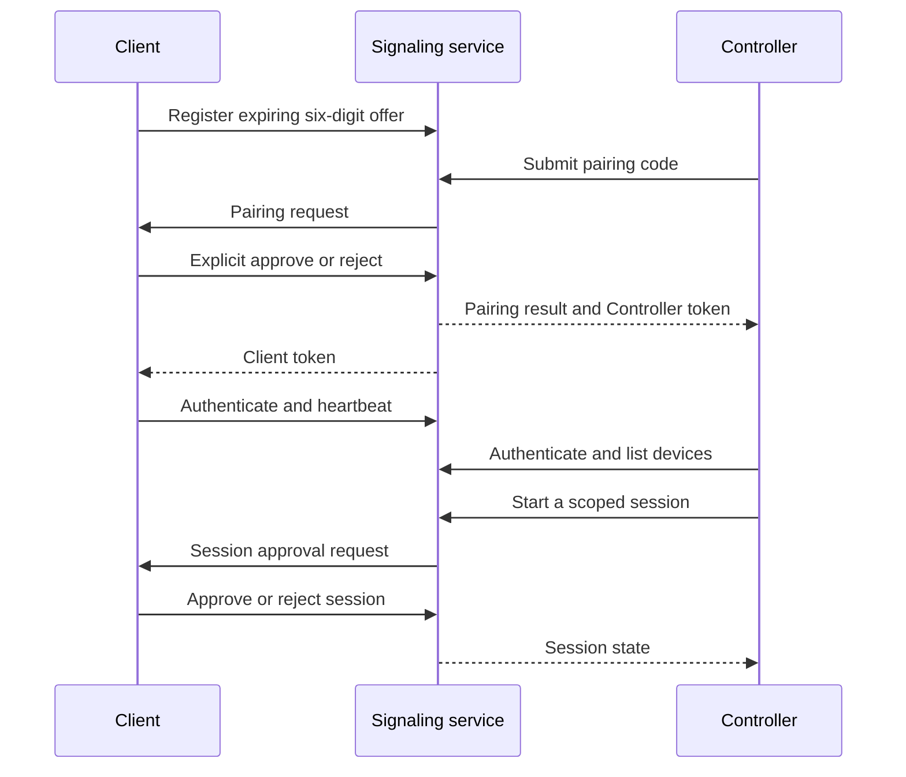

<div align="center">



# MEIZZO

**CONTROL YOUR CONNECTED WORLD.**

[](https://github.com/rakhan17/Meizzo/actions/workflows/ci.yml)
[](https://github.com/rakhan17/Meizzo/actions/workflows/ios.yml)
[](https://github.com/rakhan17/Meizzo/actions/workflows/meizzo-cloudflare.yml)
[](https://github.com/rakhan17/Meizzo/actions/workflows/docs.yml)
[](https://github.com/rakhan17/Meizzo/releases)
[](LICENSE) [](LICENSE-AGPL-3.0-only)
[](https://github.com/rakhan17/Meizzo/issues)

A consent-first device assistance platform with separate Android Client and
Controller apps, authenticated signaling, device presence, telemetry, and
session-scoped authorization.

[Downloads](#downloads) · [Documentation](#documentation) · [Architecture](#architecture) ·
[Changelog](CHANGELOG.md) · [Beta updates](UPDATES.md) · [Security](#security-and-assurance) ·
[Licensing](THIRD_PARTY_NOTICES.md) · [Releases](https://github.com/rakhan17/Meizzo/releases)

</div>

 > **Stable:** Android `v2.5.0` remains the supported stable baseline. **Beta:** the v3 development line targets `v3.0.0-beta.1`; its Android debug builds are available from CI for evaluation, while the signed GitHub prerelease is pending release publication. Beta builds are experimental and require physical-device and cross-network acceptance testing. iOS remains a separate development/Simulator track.

## What is MEIZZO?

MEIZZO is a two-app device assistance system:

- **MEIZZO Client** runs on the device being assisted. It creates a temporary
  pairing code, receives pairing and session requests, and requires the user
  to approve them.
- **MEIZZO Controller** runs on the operator's device. It pairs with authorized
  Clients, displays their connection state and telemetry, and sends supported
  device commands.

The two apps have separate package identifiers, credentials, and roles.
Pairing establishes an authorized relationship; it does not silently grant
screen capture, camera, file, location, or unrestricted interaction access.

## Downloads

Client and Controller are separate APKs. Install the app that matches the
role of each device. Stable channels are shown first; beta downloads are
clearly marked as prerelease software.

<div align="center">

[](https://github.com/rakhan17/Meizzo/releases)

</div>

### Android

#### Stable release

<sub>**STABLE CHANNEL** · `v2.5.0` · Published and available.</sub>

| App | Purpose | Download |
|:--|:--|:--|
| **MEIZZO Client** | Device receiving assistance | [](https://github.com/rakhan17/Meizzo/releases/download/v2.5.0/MEIZZO-Client-v2.5.0.apk) |
| **MEIZZO Controller** | Device managing connected Clients | [](https://github.com/rakhan17/Meizzo/releases/download/v2.5.0/MEIZZO-Controller-v2.5.0.apk) |

[](https://github.com/rakhan17/Meizzo/releases/tag/v2.5.0)

#### Beta

<sub>**V3 BETA** · `v3.0.0-beta.1` · Signed prerelease build is being validated by the dedicated beta release workflow.</sub>

| App | Purpose | Build |
|:--|:--|:--|
| **MEIZZO Client** | Install on the device receiving assistance | [Download Client beta APK](https://github.com/rakhan17/Meizzo/releases/download/v3.0.0-beta.1/MEIZZO-Client-v3.0.0-beta.1.apk) |
| **MEIZZO Controller** | Install on the operator device | [Download Controller beta APK](https://github.com/rakhan17/Meizzo/releases/download/v3.0.0-beta.1/MEIZZO-Controller-v3.0.0-beta.1.apk) |

The beta release is a prerelease and is separate from Stable `v2.5.0`. Review the [beta changelog](CHANGELOG.md) before installing. If GitHub has not finished publishing the release assets, use the [beta release page](https://github.com/rakhan17/Meizzo/releases/tag/v3.0.0-beta.1) and wait for both APKs and `MEIZZO-UPDATE.json` to appear. Do not install a debug APK over a stable build if Android reports a signing-certificate mismatch.
### iOS

iOS is still in development. Simulator builds are useful for engineering
smoke tests, but they are not installable packages for a physical iPhone.

#### Stable release

| App | Download |
|:--|:--|
| **MEIZZO Client for iOS** |  |
| **MEIZZO Controller for iOS** |  |

#### Beta

| App | Download |
|:--|:--|
| **MEIZZO Client for iOS** |  |
| **MEIZZO Controller for iOS** |  |

Physical-device distribution requires Apple signing, provisioning, and
device-level testing. Previous Simulator ZIP artifacts must not be renamed
or represented as IPA files. See the [iOS guide](docs/ios-guide.md).

## Product capabilities

### Android v3 beta capabilities (not in v2.5.0 stable)

#### Interface and interaction design

- Android Controller uses three tabs: **Link**, **Devices**, and **Settings**. Link is dedicated to entering the six-digit pairing code; successful pairing automatically opens Devices.
- Devices provides per-Client presence, device actions, remote-session entry points, and management controls.
- Settings includes light/dark appearance selection and Auto-Alert configuration.
- Android Client presents a focused single-screen pairing-code experience.
- Both apps use upstream **AndroidLiquidGlass / Backdrop 2.0.1** effects and official upstream sample components for Liquid Glass surfaces, buttons, bottom tabs, toggles, and sliders. Shared integration lives in `apps/glass-ui`.
- App-owned confirmations, warnings, and input prompts use the shared Liquid Glass dialog surface. Android-owned permission pickers and document/media system UI remain native OS surfaces.
- The design is iOS-inspired, not an Apple UI clone: Android system typography and platform permission conventions are retained.

#### Device and remote-assistance capabilities

- Six-digit pairing codes with a short lifetime and single-use behavior.
- Explicit approval on the Client before a Controller is paired.
- Separate Client and Controller identities and app credentials.
- Multiple authorized Clients per Controller with per-device status routing.
- Authenticated presence and heartbeat-based online/offline state.
- Device telemetry including battery and charging state, storage, uptime,
  network transport, and available device metadata.
- Supported device commands such as flashlight and alarm, subject to
  permissions and hardware availability.
- Session request, approval, rejection, and termination state, including Client-initiated termination.
- Live Android screen streaming prototype using MediaProjection and WebRTC.
- Android camera streaming prototype using Camera2 and WebRTC, with Controller-triggered front/rear camera switching.
- Optional two-way voice prototype: Client and Controller microphone audio tracks over WebRTC, each requiring runtime permission and an explicit in-session action. Controller uses a microphone foreground service and can mute either side locally.
- Tap, swipe, and long-press from the Controller's live video surface, gated by a separate approved interaction session.
- Remote Back, Home, Recents, notification shade, Quick Settings, power menu, and lock-screen actions through the user-enabled AccessibilityService.
- Remote text insertion at the active cursor/selection, Backspace, Enter, Tab, Escape, arrow keys, and Ctrl+A/C/V/X/Z/Y shortcuts for supported focused text editors. Android 13+ input-connection key support is used where available.
- Remote media volume up/down/mute/unmute controls during an approved interaction session.
- Manual text clipboard transfer in both directions, with a separate approval dialog on the Client for every read or overwrite.
- Save a screenshot from the active remote live-screen viewer to the Controller device.
- Remote folder browsing through a Client-granted Storage Access Framework tree URI, showing folder contents and file metadata. Individual files can be sent to the Controller after a separate file-session approval and per-file Client confirmation; folder creation, rename, and file deletion are available only when Android grants folder write access, the storage provider supports them, and the Client approves.
- Bidirectional single- and multi-file transfer prototype using WebRTC DataChannel, Storage Access Framework, acknowledged 12 KiB chunks, per-file transfer IDs, bounded chunk retries, sequence and size validation, SHA-256 verification, incremental progress, cancellation, and a 50 MiB transfer limit.
- Android foreground connection services, reconnect handling, and
  Android Keystore-backed local credential encryption.
- Release metadata, SHA-256 verification, package checks, signing-certificate
  checks, and Android Package Installer handoff for updates.

### Still in development / not release-ready

- Production TURN secret configuration and reliable media connectivity across restrictive NATs.
- Internal app/system audio capture, full hardware-keyboard and shortcut emulation, automatic clipboard synchronization, resumable file transfer, and large-file optimization.
- Physical-device acceptance testing across Android vendors and networks.
- iOS screen hosting, camera hosting, file transfer, and remote input. iOS remains a separate platform implementation.
- Android Enterprise enrollment or Managed Mode.
- Independent security audit or formal security certification.

The v3 media and file-transfer paths are implemented as Android prototypes, not
yet certified for production use. Android system consent and permissions remain
mandatory. MEIZZO-owned code retains its Apache-2.0 licensing where applicable;
any RustDesk-derived combined app component must comply with AGPL-3.0-only.
See [v3 implementation status](docs/v3/README.md),
[upstream and license notes](docs/v3/UPSTREAM_AND_LICENSES.md), and the
[security model](docs/v2/security-model.md).

## Architecture

MEIZZO separates its control plane, media plane, and presentation layer. Pairing,
authentication, presence, telemetry, commands, and session authorization use
WebSocket Secure (WSS) through the existing Cloudflare Worker and Durable Object.
After the Client approves a screen, camera, or file session, Android peers
negotiate WebRTC using WSS for offer/answer/ICE signaling; media and file bytes
travel over WebRTC, not through the Worker. STUN is configured. The Worker can
issue short-lived Cloudflare TURN credentials when its secrets are configured;
TURN availability and restrictive-network traversal still require deployment
and real-network validation. The Android presentation layer is a shared
Compose module (`apps/glass-ui`) built on AndroidLiquidGlass 2.0.1 Backdrop
effects and official upstream sample components.



### Pairing and session lifecycle



Screen, camera, and file sessions each require explicit Client approval before
WebRTC signaling is relayed. Android also requests the operating system's
MediaProjection consent for screen capture and runtime camera permission for
camera streaming. Remote taps, swipes, and lock-screen actions require the
separately approved interaction session and user-enabled AccessibilityService.

### Technology map

| Layer | Current implementation |
|---|---|
| Android apps | Kotlin, Jetpack Compose, separate Client and Controller modules |
| Android UI system | Shared `apps/glass-ui` module, AndroidLiquidGlass / Backdrop 2.0.1, upstream LiquidBottomTabs / LiquidButton / LiquidToggle / LiquidSlider examples |
| Android connection lifecycle | Foreground services, reconnect backoff, boot receivers |
| Android credential storage | AES-GCM protected values using Android Keystore keys |
| iOS apps | SwiftUI Client and Controller targets; development/Simulator track |
| Signaling protocol | JSON messages over WSS, protocol version 2 |
| Hosted signaling | Cloudflare Workers + Durable Objects |
| Android media | WebRTC video and optional two-way microphone audio, STUN/TURN, adaptive bitrate, bounded ICE recovery, MediaProjection, Camera2 |
| Android file transfer | Ordered WebRTC DataChannel, SAF folder browser, transfer IDs, acknowledged 12 KiB chunks, SHA-256 |
| Local signaling harness | Node.js + `ws`, in-memory process state |
| Release distribution | GitHub Actions and GitHub Releases |
| Android updates | Release manifest, checksum/package/signature checks, Package Installer |
| Documentation | Markdown + MkDocs Material |

The Node.js service is a local development/test harness. Its in-memory state is
not equivalent to the hosted Durable Object deployment and is lost on process
restart. See [architecture](docs/architecture.md) and
[backend deployment](docs/backend-deployment.md).

## Repository layout

| Path | Responsibility |
|---|---|
| `apps/client` | Android Client app, pairing approval, telemetry, commands |
| `apps/controller` | Android Controller app, three-tab navigation, device management and session controls |
| `apps/glass-ui` | Shared Liquid Glass surfaces, dialogs, theme integration and upstream Backdrop components |
| `ios/Client` | SwiftUI iOS Client target |
| `ios/Controller` | SwiftUI iOS Controller target |
| `ios/Shared` | Shared iOS networking and secure-storage code |
| `shared` | Shared protocol/domain resources |
| `services/signaling/cloudflare` | Hosted Worker and Durable Object implementation |
| `services/signaling/src` | Local Node.js signaling harness |
| `services/signaling/test` | Pairing, multi-device, and revocation tests |
| `scripts` | Development and BlueStacks/ADB test helpers |
| `docs` | User, architecture, API, security, deployment, and platform guides |
| `.github/workflows` | CI, release, Worker validation, iOS, and docs workflows |

## Documentation

### For users

- [Getting started](docs/getting-started.md)
- [Installation](docs/installation.md)
- [User guide](docs/user-guide.md)
- [Client guide](docs/client-guide.md)
- [Controller guide](docs/controller-guide.md)
- [Pairing](docs/pairing.md)
- [Device monitoring](docs/device-monitoring.md)
- [Troubleshooting](docs/troubleshooting.md)
- [FAQ](docs/faq.md)

### For developers and operators

- [System architecture](docs/architecture.md)
- [Beta changelog](CHANGELOG.md) · [Detailed update log](UPDATES.md)
- [Protocol and API reference](docs/api-reference.md)
- [Android development](docs/android-guide.md)
- [iOS development](docs/ios-guide.md)
- [Backend deployment](docs/backend-deployment.md)
- [Testing strategy](docs/testing.md)
- [Security and privacy](docs/security-and-privacy.md)
- [Implementation status](docs/implementation-status.md)
- [V2 architecture audit](docs/v2/architecture-audit.md)
- [Contributing guide](CONTRIBUTING.md)
- [Security reporting](SECURITY.md)
- [Support](SUPPORT.md)

The full documentation navigation is in [docs/index.md](docs/index.md). A
MkDocs site can be built locally with `mkdocs build --strict`.

## Security and assurance

Security is a product requirement, not a badge. The current beta includes
short-lived single-use pairing offers, explicit Client approval, rate-limited
pairing attempts, random authentication tokens, per-device authorization,
WSS signaling, DTLS-protected WebRTC media/data channels, Android Keystore-backed
local credentials, and session-scoped approval for sensitive operations.

Important boundaries remain:

- Hosted Durable Object state contains device relationships and authentication
  token records. Server-side token hashing/rotation, formal audit trails, and
  operational key-management procedures need further hardening.
- The local Node.js harness keeps state in process memory and is for
  development/testing only.
- Android background execution is subject to Android and OEM restrictions.
- iOS platform privacy rules remain in force.
- TURN relay is optional and depends on Cloudflare Realtime TURN secrets being configured on the existing Worker. Without a working relay, direct WebRTC connections may fail on restrictive NATs, carrier networks, or firewalls.
- File transfer is limited to 50 MiB per file. Resume is best-effort and depends on the document provider preserving access grants and supporting append semantics.
- Android OEM permission restrictions and background-execution behavior need
  physical-device validation.

**Certification status:** MEIZZO has not been independently security-audited
and does not claim ISO/IEC 27001, SOC 2, GDPR certification, or any other
third-party security certification. Automated tests and CI checks are not
certifications. A formal security review and stronger isolation/security tests
remain release-readiness work. Report vulnerabilities privately using
[SECURITY.md](SECURITY.md).

## Testing and release evidence

The Android stable release remains `v2.5.0` with its original Client and Controller APKs. The v3 beta release adds the Android remote-assistance prototype set (screen/camera streaming, optional two-way microphone audio, remote interaction and navigation, manual clipboard, remote file management and bidirectional file transfer) plus the new Liquid Glass UI. The beta candidate passed Android Client and Controller debug builds, RustDesk source/license checks, signaling contract tests, and documentation validation. The signed release workflow separately rebuilds and verifies both release APKs, package/version metadata, signing certificates, checksums, and the update manifest. The iOS Simulator workflow also passed, but this UI task does not add iOS feature parity. Debug CI artifacts are not signed release APKs and do not replace physical-device, multi-network, or security acceptance.

Relevant workflow runs:

- [Android Client + Controller CI, Liquid Glass beta candidate](https://github.com/rakhan17/Meizzo/actions/runs/43144166641)
- [iOS Simulator CI](https://github.com/rakhan17/Meizzo/actions/runs/43144166627)
- [Documentation validation](https://github.com/rakhan17/Meizzo/actions/runs/43144166568)
- [Published stable v2.5.0](https://github.com/rakhan17/Meizzo/releases/tag/v2.5.0)
- [All historical and future releases](https://github.com/rakhan17/Meizzo/releases)

**Release provenance note:** beta.5 was built by workflow run `42948592178`
from source commit `8ddb147c4af628a5166f455c6b58b4d4fbe3dc66`, while the
published tag currently resolves to `3894aba79f087974bef1bc2bacc345aed837afa2`.
The APK assets are the outputs of the successful workflow, but the tag is not
an exact source pointer. The release workflow now pins future tags to the
workflow commit; the existing beta.5 tag is left unchanged.

Automated success does not replace real-device acceptance testing. See
[testing](docs/testing.md) for the manual multi-device matrix and known gaps.

## Development

### Requirements

- JDK 17
- Android SDK Platform 37 and Build Tools 37.0.0 for the current Backdrop 2.0.1 UI integration (CI also installs Android 35 packages)
- Node.js 22 for signaling tests and local backend
- Xcode and XcodeGen for iOS Simulator development
- Python 3.12 for documentation checks

### Android debug builds

```bash
./gradlew :apps:client:assembleDebug
./gradlew :apps:controller:assembleDebug
```

### Local signaling harness

```bash
cd services/signaling
npm ci
npm run check
npm test
PORT=8080 npm start
```

The local Node.js server is an in-memory development harness. Configure debug
builds with the appropriate local WebSocket URL; do not point a release build
at an emulator-only address. The published Android beta uses the configured
WSS endpoint.

### Documentation

```bash
python -m pip install -r requirements-docs.txt
python scripts/check-doc-links.py
mkdocs build --strict
```

See [development setup](docs/development.md) for complete instructions.

## Roadmap

- [x] Separate Android Client and Controller applications
- [x] Consent-based pairing and token authentication
- [x] Multi-device presence, telemetry, and isolated routing
- [x] Hosted WSS signaling with Durable Object state
- [x] Consent-scoped session lifecycle and Client-initiated session termination
- [x] Android MediaProjection screen-stream publisher and Controller video viewer
- [x] Android Camera2 stream publisher and Controller camera viewer
- [x] Tap/swipe control mapped to the live video surface
- [x] Remote lock-screen action through AccessibilityService
- [x] Bidirectional WebRTC DataChannel file-transfer prototype
- [x] Android background connection services and reconnect handling
- [x] Signed Android beta release pipeline and in-app update verification
- [x] Shared Android Liquid Glass UI integration (Backdrop 2.0.1) and three-tab Controller navigation
- [ ] Full Android physical-device and multi-instance runtime acceptance
- [ ] Durable token hardening, rotation, audit events, and independent security review
- [ ] Configure Cloudflare Realtime TURN secrets and validate relay fallback, bitrate adaptation, and ICE recovery across physical networks
- [ ] Physical-device testing across Android OEMs and mobile networks
- [ ] Resumable and optimized file transfer
- [ ] iOS media hosting and remote interaction
- [ ] iOS physical-device signing, testing, and distribution
- [ ] Enterprise enrollment and policy management, if pursued

Roadmap items are plans, not shipped features. Track progress in
[implementation status](docs/implementation-status.md).

## License

MEIZZO project-owned source and documentation are licensed under the
[Apache License 2.0](LICENSE). Third-party dependencies, fonts, icons, and
other assets remain subject to their respective licenses. The license does
not grant rights to the MEIZZO name or branding beyond customary reference.

<div align="center">

**MEIZZO** · Android Stable 2.5.0 · Android v3 Beta 3.0.0-beta.1 · iOS under development

[Stable release](https://github.com/rakhan17/Meizzo/releases/tag/v2.5.0) ·
[Beta release](https://github.com/rakhan17/Meizzo/releases/tag/v3.0.0-beta.1) ·
[Changelog](CHANGELOG.md) · [Documentation](docs/index.md) ·
[Contributing](CONTRIBUTING.md) ·
[Security](SECURITY.md) ·
[Issues](https://github.com/rakhan17/Meizzo/issues)

</div>
