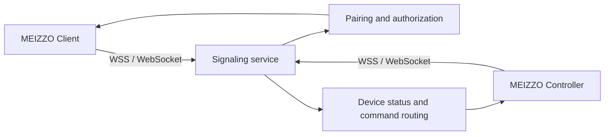

<div align="center">


# MEIZZO

**Permission-based device assistance across Android and iOS.**

Pair a managed device with a trusted Controller, approve access explicitly, and
keep each device session isolated.

[](https://github.com/rakhan17/Meizzo/actions/workflows/ci.yml)
[](https://github.com/rakhan17/Meizzo/actions/workflows/ios.yml)
[](https://github.com/rakhan17/Meizzo/releases)

</div>

> **Project status:** MEIZZO is an active beta. Pairing, authorization, device
> status, and selected device commands are implemented. Media streaming,
> unrestricted remote control, and several platform-restricted capabilities are
> not yet available.

## Product overview

MEIZZO is a two-application device assistance system:

| Application | Role |
|---|---|
| **Client** | Runs on the device being assisted. It displays a temporary six-digit pairing code and must explicitly approve every pairing request. |
| **Controller** | Runs on the operator’s device. It pairs with one or more Clients and manages each authorized device independently. |

The applications communicate through the MEIZZO signaling service rather than
requiring both devices to share a local network. Pairing codes expire, are
single-use, and are protected by request rate limits.

## Downloads

### Android

Release **v0.1.0-beta.2** is a GitHub prerelease. Client and Controller are
separate APKs with separate application IDs.

| Application | APK | Compatibility |
|---|---|---|
| **MEIZZO Client** | [Download `MEIZZO-Client-v0.1.0-beta.2.apk`](https://github.com/rakhan17/Meizzo/releases/download/v0.1.0-beta.2/MEIZZO-Client-v0.1.0-beta.2.apk) | Android 8.0+ (`com.meizzo.client`) |
| **MEIZZO Controller** | [Download `MEIZZO-Controller-v0.1.0-beta.2.apk`](https://github.com/rakhan17/Meizzo/releases/download/v0.1.0-beta.2/MEIZZO-Controller-v0.1.0-beta.2.apk) | Android 8.0+ (`com.meizzo.controller`) |

[View the Android release](https://github.com/rakhan17/Meizzo/releases/tag/v0.1.0-beta.2) ·
[Download SHA-256 checksums](https://github.com/rakhan17/Meizzo/releases/download/v0.1.0-beta.2/SHA256SUMS.txt) ·
[View all releases](https://github.com/rakhan17/Meizzo/releases)

### iOS — Beta

The current iOS build is for **iOS Simulator testing only**. These ZIP files
contain unsigned `.app` bundles and **cannot be installed on a physical
iPhone**.

| Application | Simulator artifact | Compatibility |
|---|---|---|
| **MEIZZO Client for iOS** | [Download `MEIZZO-client-iOS-simulator.zip`](https://github.com/rakhan17/Meizzo/releases/download/v0.1.0-beta.2/MEIZZO-client-iOS-simulator.zip) | iOS 16+ Simulator |
| **MEIZZO Controller for iOS** | [Download `MEIZZO-controller-iOS-simulator.zip`](https://github.com/rakhan17/Meizzo/releases/download/v0.1.0-beta.2/MEIZZO-controller-iOS-simulator.zip) | iOS 16+ Simulator |

Physical iPhone installation is not published yet. It requires an Apple
Developer team, registered devices, signing certificates, provisioning
profiles, and either an Xcode development build or TestFlight distribution.
See [the iOS build guide](docs/ios.md) for the exact setup boundary.

## Implemented capabilities

### Android

- Independent Client and Controller applications.
- Six-digit pairing codes with expiration and one-time consumption.
- Explicit Client approval before authorization.
- Multiple Clients managed by one Controller.
- Online/offline state and reconnection handling.
- Battery, charging, storage, network, uptime, and device metadata.
- Flashlight and alarm commands where the device supports them.
- Android Keystore-backed credential storage.
- Backend command routing isolated per Client.

### iOS beta

- Independent native SwiftUI Client and Controller applications.
- Separate bundle identifiers:
  - `com.meizzo.client.ios`
  - `com.meizzo.controller.ios`
- Existing WebSocket signaling and pairing protocol integration.
- Explicit Client approval.
- Controller multi-device list and online/offline state.
- Keychain-backed Controller token storage.

## Not yet available

The following features are intentionally not presented as complete:

- WebRTC camera or screen streaming.
- Android MediaProjection workflows.
- iOS ReplayKit workflows.
- Arbitrary remote touchscreen control.
- Unrestricted filesystem browsing or background file access.
- Location sharing.
- Production push notifications and background monitoring.
- Production TLS deployment and persistent cloud state.
- Signed iOS device builds or TestFlight distribution.

Platform permissions and operating-system policies are treated as product
constraints, not bypasses.

## Getting started

### Android pairing

1. Deploy or start the signaling service.
2. Install **MEIZZO Client** on the managed device.
3. Install **MEIZZO Controller** on the operator device.
4. Open Client and copy its six-digit code.
5. Enter the code in Controller.
6. Approve the request on Client.
7. Repeat the pairing flow for additional Clients.

For Android emulators, the default development endpoint is
`ws://10.0.2.2:8080`. Physical devices need a reachable LAN address or a
deployed `wss://` endpoint.

### Backend

```bash
cd services/signaling
npm ci
npm run check
npm test
PORT=8080 npm start
```

The health endpoint is available at `GET /healthz`.

### Android builds

Use JDK 17, Android SDK 35, and the repository Gradle wrapper:

```bash
./gradlew :apps:client:assembleDebug
./gradlew :apps:controller:assembleDebug
```

See [development and deployment](docs/development.md) for CI artifacts,
release builds, and the three-device test harness.

### iOS Simulator builds

On macOS with Xcode and XcodeGen:

```bash
brew install xcodegen
cd ios/Client
xcodegen generate
xcodebuild -project MEIZZOClient.xcodeproj -scheme MEIZZOClient \
  -sdk iphonesimulator -destination 'generic/platform=iOS Simulator' \
  -derivedDataPath build CODE_SIGNING_ALLOWED=NO build
```

Use `ios/Controller` and `MEIZZOController` for the Controller app. The same
build is validated by the [iOS Actions workflow](.github/workflows/ios.yml).

## Architecture



- `apps/client` — Android managed-device application.
- `apps/controller` — Android operator application.
- `ios/Client` — native SwiftUI iOS Client.
- `ios/Controller` — native SwiftUI iOS Controller.
- `ios/Shared` — shared iOS WebSocket and Keychain code.
- `services/signaling` — Node.js WebSocket service with in-memory session state.

The backend routes pairing, authorization, heartbeats, device status, snapshots,
commands, renames, and revocation. Active pairing and session state is
currently held in memory; restarting the service invalidates active sessions.

See [architecture](docs/architecture.md) and
[pairing protocol](docs/pairing-protocol.md) for protocol details.

## Security and privacy

The verified security boundary includes:

- Short-lived six-digit pairing codes.
- One-time code consumption after successful pairing.
- Explicit Client approval.
- Controller attempt rate limiting.
- Token-based post-pairing authentication.
- Per-Client command routing and authorization checks.
- Android Keystore and iOS Keychain storage for local credentials.
- No silent permission granting or hidden capture behavior.

Production deployments still require a properly configured TLS/WSS endpoint,
operational controls, and a persistent state strategy appropriate to the
deployment.

## Roadmap

| Status | Work |
|---|---|
| **Complete** | Android pairing foundation, multi-device signaling, status synchronization, selected device commands, Android release workflow, native iOS Simulator builds |
| **In progress** | iOS beta hardening, signed-device distribution preparation, broader integration testing |
| **Planned** | WebRTC media sessions, platform-approved capture flows, location and scoped file exchange, richer update delivery, production persistence |

## Documentation and support

- [Architecture](docs/architecture.md)
- [Pairing protocol](docs/pairing-protocol.md)
- [Development and deployment](docs/development.md)
- [iOS beta and signing guide](docs/ios.md)
- [Implementation status](docs/implementation-status.md)
- [Signaling service](services/signaling/README.md)
- [GitHub Releases](https://github.com/rakhan17/Meizzo/releases)
- [Issue tracker](https://github.com/rakhan17/Meizzo/issues)

When reporting a bug, include the application name, platform, OS version,
device model, workflow or release link, logs without credentials, and
reproduction steps. Contributions should preserve the independent Client and
Controller boundaries and include relevant tests or validation evidence.

## Brand asset status

The official logo source is [assets/branding/meizzo-logo.svg](assets/branding/meizzo-logo.svg).
The same geometry and black-and-white treatment is used by the Android
launcher icons, iOS AppIcon sets, in-app headers, and this README banner.

---

<div align="center">

**MEIZZO** · Android and iOS beta<br>
[Repository](https://github.com/rakhan17/Meizzo) ·
[Releases](https://github.com/rakhan17/Meizzo/releases) ·
[Issues](https://github.com/rakhan17/Meizzo/issues)

</div>
