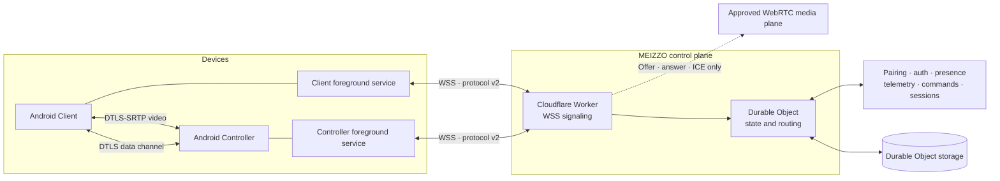
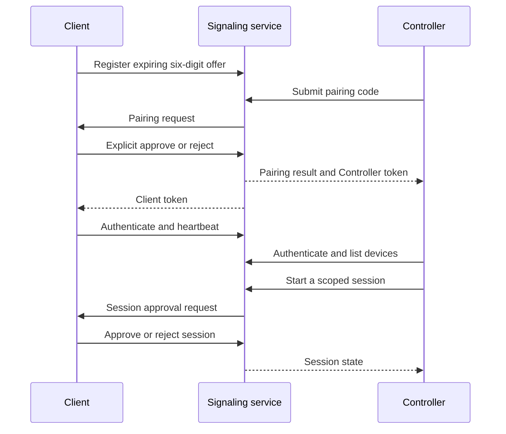

<div align="center">


# MEIZZO

**CONTROL YOUR CONNECTED WORLD.**

[](https://github.com/rakhan17/Meizzo/actions/workflows/ci.yml)
[](https://github.com/rakhan17/Meizzo/actions/workflows/ios.yml)
[](https://github.com/rakhan17/Meizzo/actions/workflows/meizzo-cloudflare.yml)
[](https://github.com/rakhan17/Meizzo/actions/workflows/docs.yml)
[](https://github.com/rakhan17/Meizzo/releases)
[](LICENSE)
[](https://github.com/rakhan17/Meizzo/issues)

A consent-first device assistance platform with separate Android Client and
Controller apps, authenticated signaling, device presence, telemetry, and
session-scoped authorization.

[Downloads](#downloads) · [Documentation](#documentation) ·
[Architecture](#architecture) · [Security](#security-and-assurance) ·
[Releases](https://github.com/rakhan17/Meizzo/releases)

</div>

 > **Current stable channel: Android v2.5.0.** The release is published. MEIZZO v3 is being developed separately on `develop/v3`, beginning at `v3.0.0-beta.1`. v3 media features are Android prototypes and still require physical-device and cross-network acceptance testing. iOS remains under development.

## What is MEIZZO?

MEIZZO is a two-app device assistance system:

- **MEIZZO Client** runs on the device being assisted. It creates a temporary
  pairing code, receives pairing and session requests, and requires the user
  to approve them.
- **MEIZZO Controller** runs on the operator's device. It pairs with authorized
  Clients, displays their connection state and telemetry, and sends supported
  device commands.

The two apps have separate package identifiers, credentials, and roles.
Pairing establishes an authorized relationship; it does not silently grant
screen capture, camera, file, location, or unrestricted interaction access.

## Downloads

Client and Controller are separate APKs. Install the app that matches the
role of each device. Stable channels are shown first; beta downloads are
clearly marked as prerelease software.

<div align="center">

[](https://github.com/rakhan17/Meizzo/releases)

</div>

### Android

#### Stable release

<sub>**STABLE CHANNEL** · `v2.5.0` · Published and available.</sub>

| App | Purpose | Download |
|:--|:--|:--|
| **MEIZZO Client** | Device receiving assistance | [](https://github.com/rakhan17/Meizzo/releases/download/v2.5.0/MEIZZO-Client-v2.5.0.apk) |
| **MEIZZO Controller** | Device managing connected Clients | [](https://github.com/rakhan17/Meizzo/releases/download/v2.5.0/MEIZZO-Controller-v2.5.0.apk) |

[](https://github.com/rakhan17/Meizzo/releases/tag/v2.5.0)

#### Beta

<sub>**V3 BETA LINE** · `v3.0.0-beta.1` · Development channel; not yet published.</sub>

| App | Purpose | Download |
|:--|:--|:--|
| **MEIZZO Client** | Install on the device receiving assistance |  |
| **MEIZZO Controller** | Install on the operator device |  |

> The v3 beta will be published only after remote media and file transfer pass physical-device, cross-network, security, and release verification.
### iOS

iOS is still in development. Simulator builds are useful for engineering
smoke tests, but they are not installable packages for a physical iPhone.

#### Stable release

| App | Download |
|:--|:--|
| **MEIZZO Client for iOS** |  |
| **MEIZZO Controller for iOS** |  |

#### Beta

| App | Download |
|:--|:--|
| **MEIZZO Client for iOS** |  |
| **MEIZZO Controller for iOS** |  |

Physical-device distribution requires Apple signing, provisioning, and
device-level testing. Previous Simulator ZIP artifacts must not be renamed
or represented as IPA files. See the [iOS guide](docs/ios-guide.md).

## Product capabilities

### Available in the Android beta

- Six-digit pairing codes with a short lifetime and single-use behavior.
- Explicit approval on the Client before a Controller is paired.
- Separate Client and Controller identities and app credentials.
- Multiple authorized Clients per Controller with per-device status routing.
- Authenticated presence and heartbeat-based online/offline state.
- Device telemetry including battery and charging state, storage, uptime,
  network transport, and available device metadata.
- Supported device commands such as flashlight and alarm, subject to
  permissions and hardware availability.
- Session request, approval, rejection, and termination state, including Client-initiated termination.
- Live Android screen streaming prototype using MediaProjection and WebRTC.
- Android camera streaming prototype using Camera2 and WebRTC.
- Tap/swipe from the Controller's live video surface, gated by a separate approved interaction session.
- Remote Android lock-screen action through the user-enabled AccessibilityService.
- Bidirectional file-transfer prototype using WebRTC DataChannel, Storage Access Framework, chunk acknowledgements, and a 50 MiB transfer limit.
- Android foreground connection services, reconnect handling, and
  Android Keystore-backed local credential encryption.
- Release metadata, SHA-256 verification, package checks, signing-certificate
  checks, and Android Package Installer handoff for updates.

### Still in development / not release-ready

- Production TURN secret configuration and reliable media connectivity across restrictive NATs.
- Adaptive bitrate, reconnect recovery, resumable file transfer, and large-file optimization.
- Physical-device acceptance testing across Android vendors and networks.
- iOS screen hosting, camera hosting, file transfer, and remote input. iOS remains a separate platform implementation.
- Android Enterprise enrollment or Managed Mode.
- Independent security audit or formal security certification.

The v3 media and file-transfer paths are implemented as Android prototypes, not
yet certified for production use. Android system consent and permissions remain
mandatory. See [v3 implementation status](docs/v3/README.md),
[upstream and license notes](docs/v3/UPSTREAM_AND_LICENSES.md), and the
[security model](docs/v2/security-model.md).

## Architecture

MEIZZO separates its control plane from its peer-to-peer media plane. Pairing,
authentication, presence, telemetry, commands, and session authorization use
WebSocket Secure (WSS) through the Cloudflare Worker and Durable Object. After
the Client approves a screen, camera, or file session, the Android apps
negotiate a direct WebRTC connection using the signaling channel. STUN is the fallback. The Worker can issue short-lived Cloudflare TURN credentials when its secrets are configured; production TURN setup remains outstanding.



### Pairing and session lifecycle



Screen, camera, and file sessions each require explicit Client approval before
WebRTC signaling is relayed. Android also requests the operating system's
MediaProjection consent for screen capture and runtime camera permission for
camera streaming. Remote taps, swipes, and lock-screen actions require the
separately approved interaction session and user-enabled AccessibilityService.

### Technology map

| Layer | Current implementation |
|---|---|
| Android apps | Kotlin, separate Client and Controller modules |
| Android connection lifecycle | Foreground services, reconnect backoff, boot receivers |
| Android credential storage | AES-GCM protected values using Android Keystore keys |
| iOS apps | SwiftUI Client and Controller targets; development/Simulator track |
| Signaling protocol | JSON messages over WSS, protocol version 2 |
| Hosted signaling | Cloudflare Workers + Durable Objects |
| Android media | WebRTC video tracks, STUN, MediaProjection, Camera2 |
| Android file transfer | Ordered WebRTC DataChannel, SAF, acknowledged 12 KiB chunks |
| Local signaling harness | Node.js + `ws`, in-memory process state |
| Release distribution | GitHub Actions and GitHub Releases |
| Android updates | Release manifest, checksum/package/signature checks, Package Installer |
| Documentation | Markdown + MkDocs Material |

The Node.js service is a local development/test harness. Its in-memory state is
not equivalent to the hosted Durable Object deployment and is lost on process
restart. See [architecture](docs/architecture.md) and
[backend deployment](docs/backend-deployment.md).

## Repository layout

| Path | Responsibility |
|---|---|
| `apps/client` | Android Client app, pairing approval, telemetry, commands |
| `apps/controller` | Android Controller app, device list, session controls |
| `ios/Client` | SwiftUI iOS Client target |
| `ios/Controller` | SwiftUI iOS Controller target |
| `ios/Shared` | Shared iOS networking and secure-storage code |
| `shared` | Shared protocol/domain resources |
| `services/signaling/cloudflare` | Hosted Worker and Durable Object implementation |
| `services/signaling/src` | Local Node.js signaling harness |
| `services/signaling/test` | Pairing, multi-device, and revocation tests |
| `scripts` | Development and BlueStacks/ADB test helpers |
| `docs` | User, architecture, API, security, deployment, and platform guides |
| `.github/workflows` | CI, release, Worker validation, iOS, and docs workflows |

## Documentation

### For users

- [Getting started](docs/getting-started.md)
- [Installation](docs/installation.md)
- [User guide](docs/user-guide.md)
- [Client guide](docs/client-guide.md)
- [Controller guide](docs/controller-guide.md)
- [Pairing](docs/pairing.md)
- [Device monitoring](docs/device-monitoring.md)
- [Troubleshooting](docs/troubleshooting.md)
- [FAQ](docs/faq.md)

### For developers and operators

- [System architecture](docs/architecture.md)
- [Protocol and API reference](docs/api-reference.md)
- [Android development](docs/android-guide.md)
- [iOS development](docs/ios-guide.md)
- [Backend deployment](docs/backend-deployment.md)
- [Testing strategy](docs/testing.md)
- [Security and privacy](docs/security-and-privacy.md)
- [Implementation status](docs/implementation-status.md)
- [V2 architecture audit](docs/v2/architecture-audit.md)
- [Contributing guide](CONTRIBUTING.md)
- [Security reporting](SECURITY.md)
- [Support](SUPPORT.md)

The full documentation navigation is in [docs/index.md](docs/index.md). A
MkDocs site can be built locally with `mkdocs build --strict`.

## Security and assurance

Security is a product requirement, not a badge. The current beta includes
short-lived single-use pairing offers, explicit Client approval, rate-limited
pairing attempts, random authentication tokens, per-device authorization,
WSS signaling, DTLS-protected WebRTC media/data channels, Android Keystore-backed
local credentials, and session-scoped approval for sensitive operations.

Important boundaries remain:

- Hosted Durable Object state contains device relationships and authentication
  token records. Server-side token hashing/rotation, formal audit trails, and
  operational key-management procedures need further hardening.
- The local Node.js harness keeps state in process memory and is for
  development/testing only.
- Android background execution is subject to Android and OEM restrictions.
- iOS platform privacy rules remain in force.
- TURN relay is not deployed. Direct WebRTC connections may fail on restrictive
  NATs, carrier networks, or firewalls.
- File transfer is limited to 50 MiB per file and is not resumable yet.
- Android OEM permission restrictions and background-execution behavior need
  physical-device validation.

**Certification status:** MEIZZO has not been independently security-audited
and does not claim ISO/IEC 27001, SOC 2, GDPR certification, or any other
third-party security certification. Automated tests and CI checks are not
certifications. A formal security review and stronger isolation/security tests
remain release-readiness work. Report vulnerabilities privately using
[SECURITY.md](SECURITY.md).

## Testing and release evidence

The v2.5.0 Android stable release is published with separate Client and Controller APKs. The v3 development branch now adds WebRTC screen/camera streaming, live-view touch control, Android lock-screen support, and bidirectional file transfer. CI builds both Android apps and runs signaling regression tests; automated builds do not replace real-device and cross-network validation.

Relevant workflow runs:

- [Android and signaling CI](https://github.com/rakhan17/Meizzo/actions/runs/42946246894)
- [iOS Simulator CI](https://github.com/rakhan17/Meizzo/actions/runs/42946246991)
- [Android beta.5 release](https://github.com/rakhan17/Meizzo/actions/runs/42948592178)

**Release provenance note:** beta.5 was built by workflow run `42948592178`
from source commit `8ddb147c4af628a5166f455c6b58b4d4fbe3dc66`, while the
published tag currently resolves to `3894aba79f087974bef1bc2bacc345aed837afa2`.
The APK assets are the outputs of the successful workflow, but the tag is not
an exact source pointer. The release workflow now pins future tags to the
workflow commit; the existing beta.5 tag is left unchanged.

Automated success does not replace real-device acceptance testing. See
[testing](docs/testing.md) for the manual multi-device matrix and known gaps.

## Development

### Requirements

- JDK 17
- Android SDK 35 or newer compatible SDK packages
- Node.js 22 for signaling tests and local backend
- Xcode and XcodeGen for iOS Simulator development
- Python 3.12 for documentation checks

### Android debug builds

```bash
./gradlew :apps:client:assembleDebug
./gradlew :apps:controller:assembleDebug
```

### Local signaling harness

```bash
cd services/signaling
npm ci
npm run check
npm test
PORT=8080 npm start
```

The local Node.js server is an in-memory development harness. Configure debug
builds with the appropriate local WebSocket URL; do not point a release build
at an emulator-only address. The published Android beta uses the configured
WSS endpoint.

### Documentation

```bash
python -m pip install -r requirements-docs.txt
python scripts/check-doc-links.py
mkdocs build --strict
```

See [development setup](docs/development.md) for complete instructions.

## Roadmap

- [x] Separate Android Client and Controller applications
- [x] Consent-based pairing and token authentication
- [x] Multi-device presence, telemetry, and isolated routing
- [x] Hosted WSS signaling with Durable Object state
- [x] Consent-scoped session lifecycle and Client-initiated session termination
- [x] Android MediaProjection screen-stream publisher and Controller video viewer
- [x] Android Camera2 stream publisher and Controller camera viewer
- [x] Tap/swipe control mapped to the live video surface
- [x] Remote lock-screen action through AccessibilityService
- [x] Bidirectional WebRTC DataChannel file-transfer prototype
- [x] Android background connection services and reconnect handling
- [x] Signed Android beta release pipeline and in-app update verification
- [ ] Full Android physical-device and multi-instance runtime acceptance
- [ ] Durable token hardening, rotation, audit events, and independent security review
- [ ] TURN relay deployment, bitrate adaptation, and network recovery
- [ ] Physical-device testing across Android OEMs and mobile networks
- [ ] Resumable and optimized file transfer
- [ ] iOS media hosting and remote interaction
- [ ] iOS physical-device signing, testing, and distribution
- [ ] Enterprise enrollment and policy management, if pursued

Roadmap items are plans, not shipped features. Track progress in
[implementation status](docs/implementation-status.md).

## License

MEIZZO project-owned source and documentation are licensed under the
[Apache License 2.0](LICENSE). Third-party dependencies, fonts, icons, and
other assets remain subject to their respective licenses. The license does
not grant rights to the MEIZZO name or branding beyond customary reference.

<div align="center">

**MEIZZO** · Android Stable 2.5.0 · iOS under development

[Stable release](https://github.com/rakhan17/Meizzo/releases/tag/v2.5.0) ·
[Documentation](docs/index.md) ·
[Contributing](CONTRIBUTING.md) ·
[Security](SECURITY.md) ·
[Issues](https://github.com/rakhan17/Meizzo/issues)

</div>
