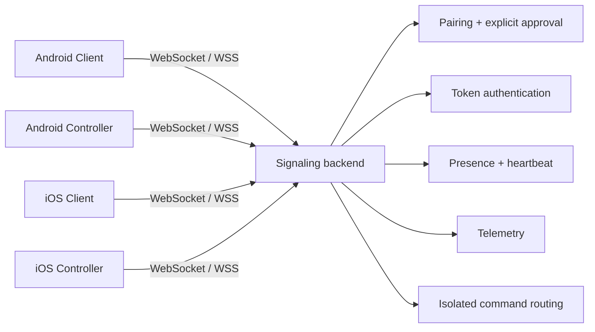
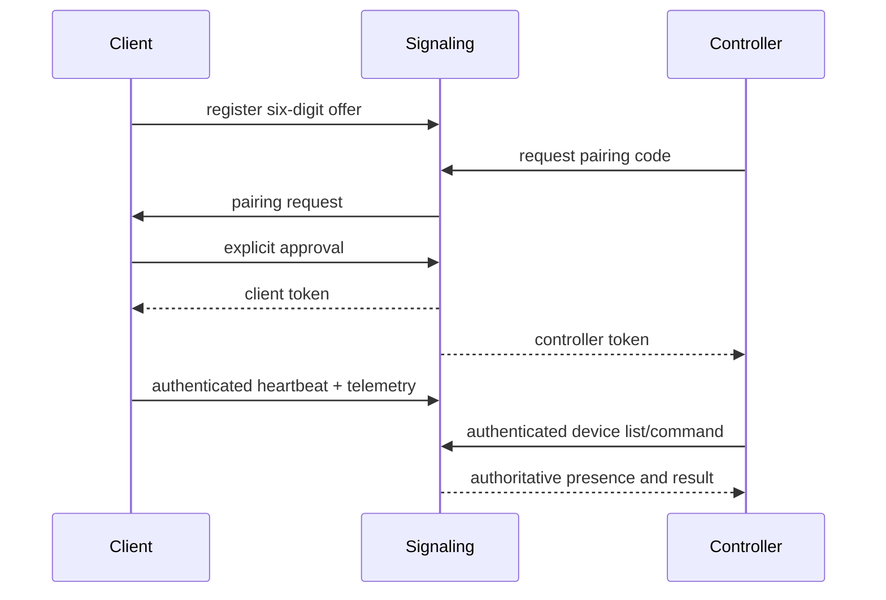

<div align="center">


# MEIZZO

**CONTROL YOUR CONNECTED WORLD.**

[](https://github.com/rakhan17/Meizzo/actions/workflows/ci.yml)
[](https://github.com/rakhan17/Meizzo/actions/workflows/ios.yml)
[](https://github.com/rakhan17/Meizzo/releases)
[](https://github.com/rakhan17/Meizzo/issues)

Permission-based device assistance for Android and iOS, built around explicit
consent, isolated sessions, and real-time device status.

[Android CI](https://github.com/rakhan17/Meizzo/actions/workflows/ci.yml) ·
[iOS CI](https://github.com/rakhan17/Meizzo/actions/workflows/ios.yml) ·
[Latest releases](https://github.com/rakhan17/Meizzo/releases)

[Documentation](https://github.com/rakhan17/Meizzo/tree/main/docs) ·
[Releases](https://github.com/rakhan17/Meizzo/releases) ·
[Issues](https://github.com/rakhan17/Meizzo/issues)

</div>

> **Beta status:** Android is the active testing platform. iOS is still
> under development and is not part of the current Android testing build.
> The Cloudflare Workers signaling endpoint is deployed over WSS and has
> passed a browser-based protocol-v2 pairing/authentication smoke test.
> Android CI debug builds are configured for this endpoint, but end-to-end
> runtime testing in BlueStacks or on physical devices is still pending.
> Media streaming, unrestricted remote control, production operations, and
> signed iOS distribution are not verified.

## Product

MEIZZO is an ecosystem of two independent applications:

- **MEIZZO Client** runs on the device receiving assistance. It displays a
  temporary six-digit code and explicitly approves pairing requests.
- **MEIZZO Controller** runs on the operator device. It pairs with and monitors
  one or more authorized Clients independently.

The signaling service works across different networks when exposed through a
reachable endpoint. Authorization is consent-based; a Controller cannot use a
Client until the Client approves the request.

## Downloads

Choose the app based on the role of each device. Client and Controller are
separate applications. Published versions are organized by platform and
release channel below.

<div align="center">

[](https://github.com/rakhan17/Meizzo/releases)

</div>

### Android

#### Stable Release

<sub>**STABLE** · No stable version published yet</sub>

| App | Purpose | Download |
|:--|:--|:--|
| **MEIZZO Client** | Device receiving assistance |  |
| **MEIZZO Controller** | Device managing connected Clients |  |

#### Beta

<sub>**LATEST BETA** · `v0.1.0-beta.4` · Version code `100304`</sub>

| App | Purpose | Download |
|:--|:--|:--|
| **MEIZZO Client** | Device receiving assistance | [](https://github.com/rakhan17/Meizzo/releases/download/v0.1.0-beta.4/MEIZZO-Client-v0.1.0-beta.4.apk) |
| **MEIZZO Controller** | Device managing connected Clients | [](https://github.com/rakhan17/Meizzo/releases/download/v0.1.0-beta.4/MEIZZO-Controller-v0.1.0-beta.4.apk) |

> **Beta software:** this build is for testing and may contain bugs. Install
> Client on the device receiving assistance and Controller on the operator's
> device. Pairing still requires explicit approval on the Client.
>
> **Upgrade note:** beta.4 is signed with the project's current release key.
> If an older installation was signed with a different key, Android may reject
> an in-place update. Back up any important app data before uninstalling an
> older build; uninstalling removes that app's local data.

### iOS

iOS builds are not ready for public installation. Both release channels are
shown for visibility, but downloads remain disabled until iOS development,
signing, and device testing are complete.

#### Stable Release

<sub>**STABLE** · Under development</sub>

| App | Purpose | Download |
|:--|:--|:--|
| **MEIZZO Client for iOS** | Device receiving assistance |  |
| **MEIZZO Controller for iOS** | Device managing connected Clients |  |

#### Beta

<sub>**BETA** · Under development</sub>

| App | Purpose | Download |
|:--|:--|:--|
| **MEIZZO Client for iOS** | Device receiving assistance |  |
| **MEIZZO Controller for iOS** | Device managing connected Clients |  |

<sub>Previous unsigned Simulator ZIPs were intended only for Xcode on Mac and
cannot be installed directly on a physical iPhone. They are intentionally not
presented as public iOS downloads.</sub>

[Read the iOS development guide](docs/ios-guide.md)

## Feature overview

**Android:** six-digit pairing, explicit approval, multi-device management,
authoritative presence, heartbeat telemetry, battery and charging state,
network type, storage, RAM where exposed, device metadata, flashlight and
alarm commands where supported, Android Keystore credentials, and isolated
command routing.

**iOS (under development):** native SwiftUI Client and Controller targets are
in the repository, but iOS is not included in this Android-focused beta
milestone. Feature parity, distribution, and runtime validation remain
pending.

## Screenshots

No production screenshots are committed yet. Do not treat mockups as runtime
evidence. The capture workflow and naming convention are documented in
[docs/assets/screenshots/README.md](docs/assets/screenshots/README.md).

## Architecture





## Repository

| Path | Responsibility |
|---|---|
| `apps/client` | Android Client, telemetry, consent UI, commands, updater |
| `apps/controller` | Android Controller, multi-device dashboard, updater |
| `ios/Client` | SwiftUI iOS Client target and Simulator project definition |
| `ios/Controller` | SwiftUI iOS Controller target and Simulator project definition |
| `ios/Shared` | iOS WebSocket, reconnect, heartbeat, and Keychain code |
| `services/signaling` | Node.js WebSocket pairing, auth, presence, telemetry, routing |
| `scripts` | Manual BlueStacks/ADB harnesses |
| `docs` | User, developer, platform, security, and release documentation |
| `.github/workflows` | Android, iOS Simulator, iOS device, release, and docs CI |

## Documentation

- [Quick start](docs/getting-started.md)
- [User manual](docs/user-guide.md)
- [Client guide](docs/client-guide.md)
- [Controller guide](docs/controller-guide.md)
- [Pairing](docs/pairing.md)
- [Device monitoring](docs/device-monitoring.md)
- [Development setup](docs/development.md)
- [Architecture](docs/architecture.md)
- [API reference](docs/api-reference.md)
- [Testing](docs/testing.md)
- [Android guide](docs/android-guide.md)
- [iOS guide](docs/ios-guide.md)
- [Backend deployment](docs/backend-deployment.md)
- [Security and privacy](docs/security-and-privacy.md)
- [Contributing](CONTRIBUTING.md)
- [Security reporting](SECURITY.md)
- [Support](SUPPORT.md)

## Security, privacy, and limitations

Pairing requires a short-lived code and explicit Client approval. Tokens are
stored in Android Keystore or iOS Keychain. Device sessions and commands are
isolated by Client identity. Logs must not contain credentials, pairing codes,
or personal data.

The Cloudflare Workers signaling endpoint is deployed with WSS and a
Durable Object binding. Its browser-based smoke test has verified protocol-v2
handshake, pairing approval, token issuance/authentication, heartbeat, online
presence, and device-list delivery. This does not yet establish end-to-end
compatibility with the Android apps or production operational readiness.
Complete Android runtime testing, review persistence/retention behavior, and
apply operational safeguards before treating the service as production-ready.
iOS system restrictions prevent unrestricted touch control, arbitrary file
access, and silent screen capture. See [security and privacy](docs/security-and-privacy.md)
and [implementation status](docs/implementation-status.md).

## Development

```bash
cd services/signaling
npm ci
npm run check
npm test
PORT=8080 npm start
```

For Android debug builds, use JDK 17, Android SDK 35, and:

```bash
./gradlew :apps:client:assembleDebug
./gradlew :apps:controller:assembleDebug
```

Debug and release builds default to the deployed MEIZZO signaling
endpoint, `wss://meizzo-signaling.rakhanatanox.workers.dev`. The CI workflow
also accepts an optional `meizzo.debugSignalingUrl` Gradle property for
testing against another endpoint. Cleartext traffic is disabled. For local
Node signaling development, explicitly override the endpoint and configure
the emulator host appropriately. See [Android development](docs/android-guide.md).

## License status

No repository license has been finalized. Until the owner approves a license,
the source should not be described as open-source software. Apache License 2.0
is documented as the recommended option in [docs/license.md](docs/license.md).

<div align="center">

**MEIZZO** · Android and iOS beta ·
[Documentation](docs/index.md) · [Releases](https://github.com/rakhan17/Meizzo/releases) ·
[Issues](https://github.com/rakhan17/Meizzo/issues)

</div>
