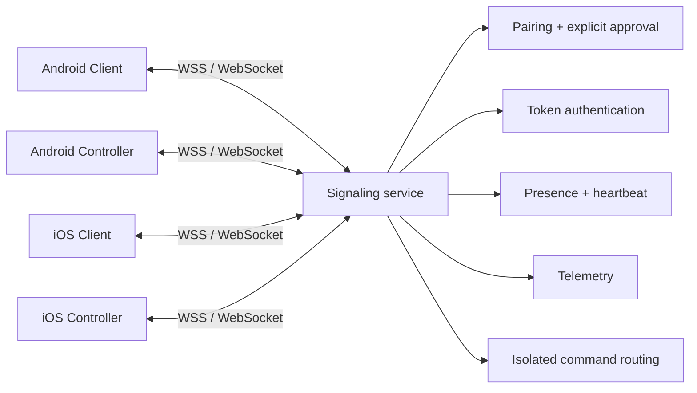
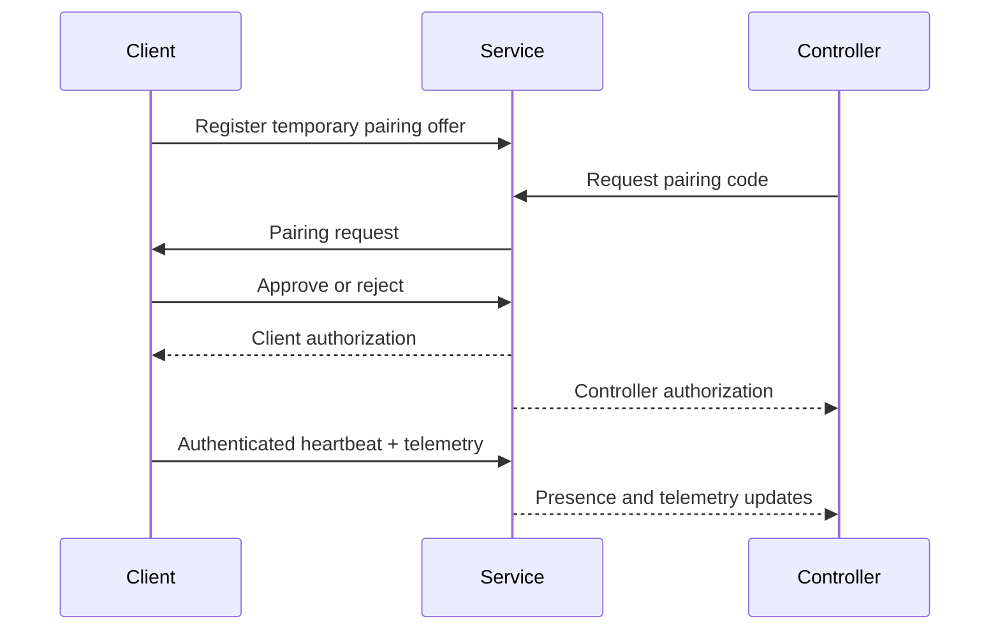

<div align="center">


# MEIZZO

**CONTROL YOUR CONNECTED WORLD.**

Consent-first device assistance for Android and iOS, with separate Client and Controller applications.

[](https://github.com/rakhan17/Meizzo/actions/workflows/ci.yml)
[](https://github.com/rakhan17/Meizzo/actions/workflows/ios.yml)
[](https://github.com/rakhan17/Meizzo/releases)

[Documentation](docs/index.md) · [Releases](https://github.com/rakhan17/Meizzo/releases) · [Support](SUPPORT.md) · [Contributing](CONTRIBUTING.md)

</div>

> **Beta software.** Android pairing, approval, presence, telemetry, and selected device commands are implemented. iOS Simulator builds are validated. Do not assume build success means physical-device or cross-network runtime validation. See [implementation status](docs/implementation-status.md).

## At a glance

MEIZZO has two independently installed applications:

| | Client | Controller |
|---|---|---|
| Role | Device receiving assistance | Device initiating authorized assistance |
| Main job | Pairing offer, approval, status, telemetry | Pairing, multi-device dashboard, authorized actions |
| Android package | `com.meizzo.client` | `com.meizzo.controller` |
| iOS bundle | `com.meizzo.client.ios` | `com.meizzo.controller.ios` |

A pairing code is temporary discovery, not permission. The Client must explicitly approve a pairing request before the Controller is authorized.

## Downloads

### Android

The latest published Android release is **v0.1.0-beta.3**. It is an older beta and is known to contain the legacy `ws://10.0.2.2:8080` endpoint behavior. It is **not recommended for validating the BlueStacks Air connectivity fix**.

| App | Download | Package |
|---|---|---|
| MEIZZO Client | [Download beta.3 APK](https://github.com/rakhan17/Meizzo/releases/download/v0.1.0-beta.3/MEIZZO-Client-v0.1.0-beta.3.apk) | `com.meizzo.client` |
| MEIZZO Controller | [Download beta.3 APK](https://github.com/rakhan17/Meizzo/releases/download/v0.1.0-beta.3/MEIZZO-Controller-v0.1.0-beta.3.apk) | `com.meizzo.controller` |

[Release notes](https://github.com/rakhan17/Meizzo/releases/tag/v0.1.0-beta.3) · [All releases](https://github.com/rakhan17/Meizzo/releases) · [SHA-256 checksums](https://github.com/rakhan17/Meizzo/releases/download/v0.1.0-beta.3/SHA256SUMS.txt)

**BlueStacks Air testing:** build fresh debug APKs with the Mac's reachable LAN address. The default `10.0.2.2` is not guaranteed to route from BlueStacks Air. Follow [the BlueStacks Air guide](docs/bluestacks-air.md). The CI debug artifacts are not published releases and must be configured with the correct endpoint before use.

### iOS

The published iOS downloads are **Simulator ZIP artifacts**, not iPhone-installable IPA files.

- [MEIZZO Client Simulator ZIP](https://github.com/rakhan17/Meizzo/releases/download/v0.1.0-beta.3/MEIZZO-client-iOS-simulator.zip)
- [MEIZZO Controller Simulator ZIP](https://github.com/rakhan17/Meizzo/releases/download/v0.1.0-beta.3/MEIZZO-controller-iOS-simulator.zip)

Physical iPhone installation requires a signed device build and provisioning profile, or TestFlight/App Store distribution. See [iOS distribution guide](docs/ios-guide.md).

## Product capabilities

**Android beta**
- Six-digit, expiring pairing code and explicit Client approval.
- Separate Client and Controller identities and secure token storage.
- Multi-Client Controller dashboard with isolated device state.
- Authenticated presence, heartbeat, and device telemetry.
- Battery/charging, storage, network type, memory and device metadata where the platform exposes them.
- Selected commands such as flashlight and alarm, subject to hardware and permission availability.
- App update checks and user-approved Android Package Installer flow, subject to release signing compatibility.

**iOS beta**
- Separate native SwiftUI Client and Controller targets.
- Pairing and approval flow, Keychain-backed credentials, and Simulator smoke tests.
- Platform-supported status and telemetry only.
- No claim of unrestricted touch control, silent screen capture, arbitrary file browsing, or Android-equivalent background behavior.

## Architecture





## Repository map

| Directory | Purpose |
|---|---|
| `apps/client` | Android Client |
| `apps/controller` | Android Controller |
| `ios/Client`, `ios/Controller` | Native iOS app targets |
| `ios/Shared` | Shared iOS networking and secure storage |
| `services/signaling` | Node.js WebSocket signaling backend |
| `docs` | User, platform, developer, operations, and security docs |
| `.github/workflows` | CI, iOS Simulator/device, release, and documentation workflows |

## Documentation

| Audience | Start here |
|---|---|
| New users | [Quick start](docs/getting-started.md) · [User manual](docs/user-guide.md) |
| Client users | [Client guide](docs/client-guide.md) |
| Controller users | [Controller guide](docs/controller-guide.md) |
| Device information | [Telemetry reference](docs/device-monitoring.md) |
| BlueStacks Air | [Network and installation guide](docs/bluestacks-air.md) |
| Android developers | [Android guide](docs/android-guide.md) |
| iOS developers | [iOS guide](docs/ios-guide.md) |
| Backend operators | [Deployment guide](docs/backend-deployment.md) |
| Contributors | [Contributing](CONTRIBUTING.md) |
| Security reports | [Security policy](SECURITY.md) |
| Project support | [Support](SUPPORT.md) |

Full navigation is available in the [documentation index](docs/index.md).

## Build and test

### Signaling service

```bash
cd services/signaling
npm ci
npm run check
npm test
PORT=8080 npm start
```

### Android

Use JDK 17 and Android SDK 35:

```bash
./gradlew :apps:client:assembleDebug
./gradlew :apps:controller:assembleDebug
```

For BlueStacks Air, set `-Pmeizzo.debugSignalingUrl=ws://<MAC-LAN-IP>:8080` on **both** builds. Do not assume `10.0.2.2` is reachable. Release builds must use a real WSS endpoint; the placeholder endpoint is intentionally blocked from production release.

### iOS

Use the documented XcodeGen and macOS Simulator workflow. Simulator ZIPs are not physical-device IPAs.

## Security and privacy

Pairing requires explicit Client approval. Tokens are stored using Android Keystore-backed storage or iOS Keychain. Authenticated device sessions must remain isolated. Production deployments require TLS/WSS, appropriate operational controls, and a reviewed persistence strategy. The current signaling service keeps active state in memory.

Read [Security and privacy](docs/security-and-privacy.md), [Security policy](SECURITY.md), and [known implementation status](docs/implementation-status.md).

## License

**No project license has been selected or committed.** Until the repository owner approves and adds a root `LICENSE` file, do not assume that public visibility grants permission to reuse or redistribute this code. See [license status and recommendation](docs/license.md).

---

<div align="center">

**MEIZZO** · Cross-platform device assistance · Beta

[Documentation](docs/index.md) · [Releases](https://github.com/rakhan17/Meizzo/releases) · [Report a bug](https://github.com/rakhan17/Meizzo/issues)

</div>
