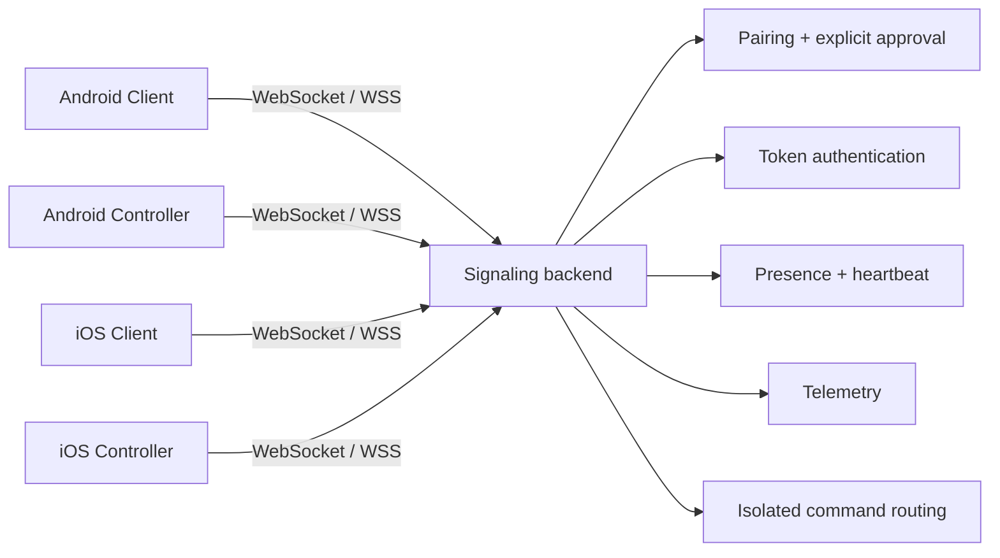
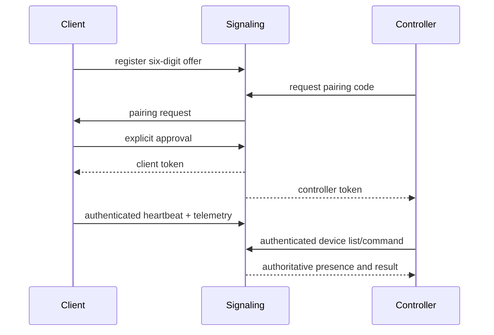

<div align="center">


# MEIZZO

**CONTROL YOUR CONNECTED WORLD.**

Permission-based device assistance for Android and iOS, built around explicit
consent, isolated sessions, and real-time device status.

[Android CI](https://github.com/rakhan17/Meizzo/actions/workflows/ci.yml) ·
[iOS CI](https://github.com/rakhan17/Meizzo/actions/workflows/ios.yml) ·
[Latest releases](https://github.com/rakhan17/Meizzo/releases)

[Documentation](https://github.com/rakhan17/Meizzo/tree/main/docs) ·
[Releases](https://github.com/rakhan17/Meizzo/releases) ·
[Issues](https://github.com/rakhan17/Meizzo/issues)

</div>

> **Beta status:** Android is the active testing platform for this release.
> iOS is still under development and is not part of the current downloadable
> build. Media streaming, unrestricted remote control, production TLS
> deployment, persistence, and signed iOS distribution remain outside the
> verified beta boundary.

## Product

MEIZZO is an ecosystem of two independent applications:

- **MEIZZO Client** runs on the device receiving assistance. It displays a
  temporary six-digit code and explicitly approves pairing requests.
- **MEIZZO Controller** runs on the operator device. It pairs with and monitors
  one or more authorized Clients independently.

The signaling service works across different networks when exposed through a
reachable endpoint. Authorization is consent-based; a Controller cannot use a
Client until the Client approves the request.

## Downloads

Select the app based on the role of the device. Client and Controller are
separate Android applications.

### Android

<sub>**LATEST BETA** &nbsp; `v0.1.0-beta.3`</sub>

| App | Purpose | Download |
|:--|:--|:--|
| **MEIZZO Client** | Device receiving assistance | [Download Client APK](https://github.com/rakhan17/Meizzo/releases/download/v0.1.0-beta.3/MEIZZO-Client-v0.1.0-beta.3.apk) |
| **MEIZZO Controller** | Device managing connected Clients | [Download Controller APK](https://github.com/rakhan17/Meizzo/releases/download/v0.1.0-beta.3/MEIZZO-Controller-v0.1.0-beta.3.apk) |

> **Beta software:** bugs may occur. Install Client on the device being
> assisted and Controller on the operator's device.

**Stable:** <sub>Not released yet</sub> · **All versions:** [Browse MEIZZO releases](https://github.com/rakhan17/Meizzo/releases)

### iOS

<sub>**UNDER DEVELOPMENT** · Latest available simulator package: `v0.1.0-beta.3`</sub>

| App | Download |
|:--|:--|
| **MEIZZO Client for iOS** | [Download Simulator ZIP](https://github.com/rakhan17/Meizzo/releases/download/v0.1.0-beta.3/MEIZZO-client-iOS-simulator.zip) |
| **MEIZZO Controller for iOS** | [Download Simulator ZIP](https://github.com/rakhan17/Meizzo/releases/download/v0.1.0-beta.3/MEIZZO-controller-iOS-simulator.zip) |

<sub>Unsigned Simulator packages for Xcode on Mac only. They cannot be
installed directly on a physical iPhone. iOS is not part of the current
Android beta.</sub>

[Read the iOS development guide](docs/ios-guide.md)

## Feature overview

**Android:** six-digit pairing, explicit approval, multi-device management,
authoritative presence, heartbeat telemetry, battery and charging state,
network type, storage, RAM where exposed, device metadata, flashlight and
alarm commands where supported, Android Keystore credentials, and isolated
command routing.

**iOS (under development):** native SwiftUI Client and Controller targets are
in the repository, but iOS is not included in this Android-focused beta
milestone. Feature parity, distribution, and runtime validation remain
pending.

## Screenshots

No production screenshots are committed yet. Do not treat mockups as runtime
evidence. The capture workflow and naming convention are documented in
[docs/assets/screenshots/README.md](docs/assets/screenshots/README.md).

## Architecture





## Repository

| Path | Responsibility |
|---|---|
| `apps/client` | Android Client, telemetry, consent UI, commands, updater |
| `apps/controller` | Android Controller, multi-device dashboard, updater |
| `ios/Client` | SwiftUI iOS Client target and Simulator project definition |
| `ios/Controller` | SwiftUI iOS Controller target and Simulator project definition |
| `ios/Shared` | iOS WebSocket, reconnect, heartbeat, and Keychain code |
| `services/signaling` | Node.js WebSocket pairing, auth, presence, telemetry, routing |
| `scripts` | Manual BlueStacks/ADB harnesses |
| `docs` | User, developer, platform, security, and release documentation |
| `.github/workflows` | Android, iOS Simulator, iOS device, release, and docs CI |

## Documentation

- [Quick start](docs/getting-started.md)
- [User manual](docs/user-guide.md)
- [Client guide](docs/client-guide.md)
- [Controller guide](docs/controller-guide.md)
- [Pairing](docs/pairing.md)
- [Device monitoring](docs/device-monitoring.md)
- [Development setup](docs/development.md)
- [Architecture](docs/architecture.md)
- [API reference](docs/api-reference.md)
- [Testing](docs/testing.md)
- [Android guide](docs/android-guide.md)
- [iOS guide](docs/ios-guide.md)
- [Backend deployment](docs/backend-deployment.md)
- [Security and privacy](docs/security-and-privacy.md)
- [Contributing](CONTRIBUTING.md)
- [Security reporting](SECURITY.md)
- [Support](SUPPORT.md)

## Security, privacy, and limitations

Pairing requires a short-lived code and explicit Client approval. Tokens are
stored in Android Keystore or iOS Keychain. Device sessions and commands are
isolated by Client identity. Logs must not contain credentials, pairing codes,
or personal data.

The current backend stores active pairing and authorization state in memory.
Production deployments require TLS/WSS, a stable deployment, operational
limits, and a persistent state strategy. iOS system restrictions prevent
unrestricted touch control, arbitrary file access, and silent screen capture.
See [security and privacy](docs/security-and-privacy.md) and
[implementation status](docs/implementation-status.md).

## Development

```bash
cd services/signaling
npm ci
npm run check
npm test
PORT=8080 npm start
```

For Android debug builds, use JDK 17, Android SDK 35, and:

```bash
./gradlew :apps:client:assembleDebug
./gradlew :apps:controller:assembleDebug
```

Debug builds default to `ws://10.0.2.2:8080` for an Android emulator or
BlueStacks instance. Release builds require
`-Pmeizzo.releaseSignalingUrl=wss://your-host.example` and do not permit
cleartext traffic. See [Android development](docs/android-guide.md).

## License status

No repository license has been finalized. Until the owner approves a license,
the source should not be described as open-source software. Apache License 2.0
is documented as the recommended option in [docs/license.md](docs/license.md).

<div align="center">

**MEIZZO** · Android and iOS beta ·
[Documentation](docs/index.md) · [Releases](https://github.com/rakhan17/Meizzo/releases) ·
[Issues](https://github.com/rakhan17/Meizzo/issues)

</div>
