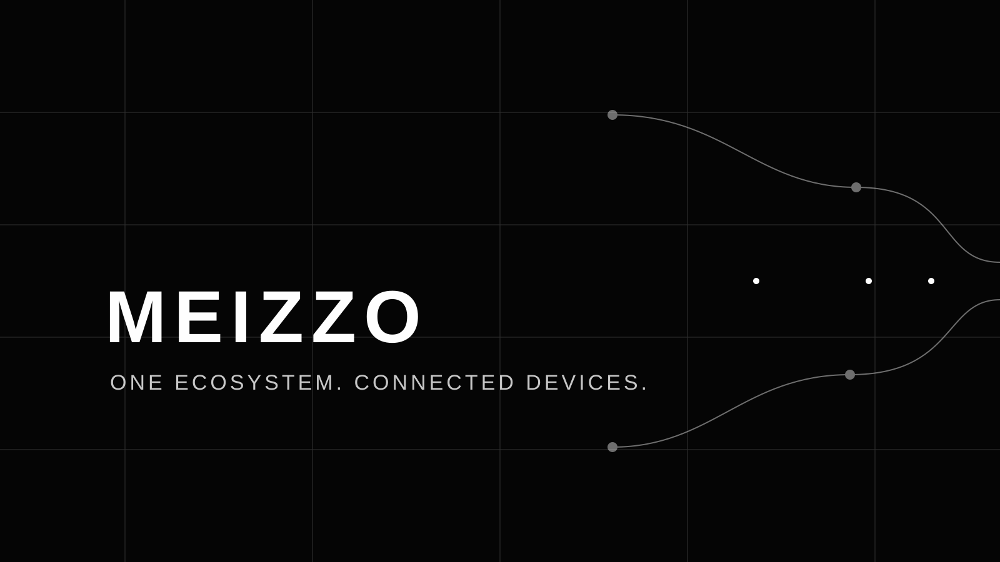

# SECURITY POLICY

**Protect the people, devices, and trust behind every session.**

MEIZZO handles device identity, pairing, telemetry, and remote-assistance workflows. Security reports are welcome. Responsible disclosure gives maintainers an opportunity to investigate and prepare a fix without unnecessarily exposing users.

> **Please do not publish an exploitable vulnerability in a public issue, discussion, pull request, or screenshot.**

## Security status

| Area | Current policy |
|---|---|
| Active development | `main` |
| Latest published beta | Best-effort security review |
| Older beta releases | Upgrade to the latest supported build where possible |
| Unreleased commits | Development snapshots, without release-level support guarantees |

MEIZZO is beta software. Prerelease builds may contain unresolved defects and are not represented as suitable for sensitive production workloads. This policy does not create a guaranteed response-time SLA.

## 1. Report a vulnerability privately

### Preferred reporting route

If GitHub private vulnerability reporting is enabled for this repository, use the repository's **Security → Advisories → Report a vulnerability** flow.

If private reporting is unavailable, contact the repository owner through a private GitHub channel and request a secure reporting route. Do not publish exploit details while waiting for a response.

### Include useful details

Where safe, provide:

- Affected application, service, platform, release, and commit.
- A concise description of the security impact.
- Realistic attack prerequisites and affected trust boundaries.
- Reproduction steps or a minimal proof of concept.
- Sanitized logs, timestamps, and relevant configuration.
- Suggested mitigation, if known.

### Never include

- Passwords or account recovery information.
- Access tokens, refresh tokens, or pairing codes.
- Private keys, keystores, provisioning profiles, or signing certificates.
- Production customer data or personal files.
- Unredacted logs containing private network or device identifiers.
- A weaponized exploit against systems you do not own or have permission to test.

Only test against devices, accounts, and infrastructure you own or are explicitly authorized to assess.

## 2. What happens after a report

The maintainer will make a reasonable, best-effort effort to:

1. **Acknowledge** the report when practical.
2. **Assess** its validity, severity, scope, and prerequisites.
3. **Reproduce** the issue in a controlled environment where possible.
4. **Coordinate** a fix or mitigation and assess affected versions.
5. **Communicate** relevant remediation guidance.
6. **Credit** the reporter if they want public recognition.

No fixed acknowledgement or remediation deadline is promised. Please avoid public disclosure until a coordinated disclosure decision has been made, unless applicable law or an immediate safety concern requires otherwise.

## 3. Security boundaries

The following principles are essential to MEIZZO's security model.

### Pairing and identity

- Pairing codes must be temporary, single-use, and protected against guessing.
- A pairing code is not authorization. The Client must explicitly approve a new pairing relationship.
- Tokens must be scoped to the correct Client and Controller relationship.
- Revocation must prevent subsequent use of the revoked authorization.
- Authentication state must not be inferred from device presence alone.

### Transport and credentials

- Production signaling must use HTTPS/WSS with normal certificate validation.
- Cleartext exceptions must be restricted to explicitly configured debug builds.
- Android credentials must use Android Keystore-backed storage where appropriate.
- iOS credentials must use Keychain.
- Secrets must never be committed, embedded in public artifacts, or written to logs.
- Certificate validation must not be disabled to work around connectivity problems.

### Sessions, presence, and commands

- Presence and telemetry must be associated with authenticated identities.
- A stale disconnect must not overwrite a newer active connection.
- Commands and events must not cross Client session boundaries.
- Sensitive capabilities must respect platform permissions and explicit user consent.
- Session termination and authorization revocation must trigger appropriate cleanup.

### Device privacy

- Collect only information required for the stated feature.
- Do not expose location, camera, screen, files, or other sensitive capabilities without the required permission and authorization.
- Do not bypass Android or iOS security controls.
- Do not hide active sensitive operations from the device user.

## 4. Known architectural limitations

The signaling service has used in-memory state. Where that remains true in the deployed revision, a service restart can invalidate active pairing or session state.

A production deployment requires a reviewed persistence strategy, TLS termination, operational monitoring, rate limiting, access controls, backup and recovery planning, and an incident-response process.

Android and iOS expose different capabilities. A platform limitation must be handled as a limitation, not treated as an invitation to bypass the operating system.

Consult [Security and privacy](docs/security-and-privacy.md), [Architecture](docs/architecture.md), and [Implementation status](docs/implementation-status.md) for implementation-specific details.

## 5. Dependency and secret hygiene

If you suspect a compromised dependency, leaked signing material, or exposed credential:

- Report it privately.
- Identify the affected package, workflow, artifact, or commit.
- Avoid copying the secret into the report.
- Rotate or revoke exposed credentials immediately when you control them.
- Review Git history, CI logs, release artifacts, and downstream copies.

Deleting a secret from the latest commit is not sufficient. It may remain in Git history, logs, caches, or published artifacts.

## 6. Scope and safe research

Security testing must be limited to systems and accounts you own or have explicit permission to test.

Do not perform destructive testing, denial-of-service activity, social engineering, privacy-invasive monitoring, or unauthorized access against other users or infrastructure.

If a report involves a third-party dependency or service, include enough information to identify the affected component without exposing another party's private data.

## 7. Policy updates

This policy may evolve as MEIZZO's architecture, deployment model, and release process mature. The repository's current policy is the version on the active `main` branch.

---

**SECURITY IS A PRODUCT FEATURE.**

[Report through GitHub](https://github.com/rakhan17/Meizzo/security) · [Contributing](CONTRIBUTING.md) · [Code of Conduct](CODE_OF_CONDUCT.md)

