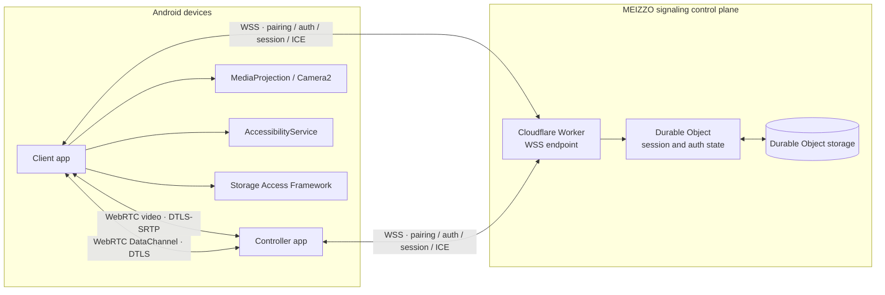

# MEIZZO architecture

**Scope:** Android v3 development branch and hosted signaling implementation.
This document distinguishes code implementation from production readiness.

## 1. System overview

MEIZZO separates the control plane from the peer-to-peer media plane:

- **Client:** runs on the Android device being assisted. It owns pairing
  approval, session consent, telemetry, screen capture, camera capture,
  file-transfer consent, and local actions.
- **Controller:** runs on the operator's Android device. It manages paired
  Clients, requests scoped sessions, renders live video, sends approved
  touch gestures, and transfers files.
- **Signaling control plane:** Cloudflare Worker and Durable Object authenticate
  both roles and route pairing, presence, telemetry, commands, session state,
  and WebRTC offer/answer/ICE messages.
- **Media plane:** Android Client and Controller establish WebRTC peer
  connections after Client approval. Video uses WebRTC media tracks. File
  content uses an ordered WebRTC DataChannel. WSS carries signaling only.

The default Android ICE configuration uses Cloudflare STUN. The Worker can
issue short-lived Cloudflare Realtime TURN credentials when its server-side
secrets are configured. Without TURN, direct media connectivity is not
guaranteed through restrictive NATs, carrier-grade NAT, or firewalls.

## 2. Android application architecture

Client and Controller are separate Kotlin applications:

| App | Application ID | Responsibilities |
|---|---|---|
| Client | `com.meizzo.client` | Pairing, session consent, MediaProjection, Camera2, AccessibilityService, SAF file selection |
| Controller | `com.meizzo.controller` | Pairing, device list, session requests, WebRTC video viewer, touch input, file picker |

The Client uses Android's system MediaProjection consent dialog before screen
capture. Screen sharing runs through a foreground service declared with the
`mediaProjection` service type. Camera streaming requires runtime CAMERA
permission. The user must manually enable MEIZZO's AccessibilityService before
remote gestures and lock-screen actions can run.

The apps use foreground connection services to maintain signaling while
Android permits background execution. This does not override force-stop,
battery optimization, OEM autostart policy, revoked permissions, or network
availability.

### Local credential storage

Android app credentials are encrypted using AES-GCM with app-specific keys
generated by Android Keystore. The Client and Controller use separate aliases
and separate app sandboxes.

## 3. Signaling service

### Hosted implementation

The deployed endpoint is a Cloudflare Worker configured in root
`wrangler.toml`. The Worker upgrades WebSocket requests and forwards them to
the `MeizzoSignaling` Durable Object. The Durable Object owns live sockets
and persists state through Durable Object storage.

Current responsibilities include:

- Protocol hello and capability advertisement (protocol version 2).
- Six-digit pairing offers, expiry, one-time consumption, and rate limiting.
- Client and Controller token authentication.
- Per-Client authorization and multi-Controller relationships.
- Heartbeat, online/offline presence, and telemetry snapshots.
- Device list, rename, revoke, snapshot, and supported command routing.
- Session request, Client approval/rejection, Client or Controller termination,
  and reconnect cleanup.
- Participant-bound WebRTC offer, answer, and ICE candidate relay for approved
  `screen`, `camera`, and `files` sessions.

The Worker routes signaling. It does not relay the actual video or file bytes.

### Local development implementation

`services/signaling/src/server.js` is a Node.js + `ws` harness for local
development and automated tests. It uses process-local Maps and loses state
when the process restarts.

## 4. Pairing and authentication

1. Client registers a six-digit pairing offer with an expiry.
2. Controller submits the code.
3. Signaling checks the offer, expiry, and attempt limits.
4. Client receives a pairing request and must explicitly approve it.
5. Signaling consumes the offer and issues role-specific random credentials.
6. Both apps authenticate using their own credential.
7. Controller receives the authorized Client list and presence updates.

Pairing authorizes a relationship, not every capability. Screen, camera, file,
and interaction sessions each require a separate Client decision.

## 5. Session authorization and media negotiation

The signaling protocol recognizes `monitoring`, `screen`, `camera`,
`interaction`, and `files` session types.

For a screen, camera, or file session:

1. Controller sends `controller.start_session`.
2. Client receives a pending session request and explicitly approves or denies.
3. Only an approved session may exchange `media.signal` messages.
4. Controller and Client exchange WebRTC offer, answer, and ICE candidates
   through the authenticated WSS signaling channel.
5. Media or file content travels directly over WebRTC, not through WSS.
6. Either participant can terminate an approved media session.

Screen capture additionally requires MediaProjection system consent. Camera
capture additionally requires CAMERA permission. File transfer requires the
receiving user to select a destination through Android's Storage Access
Framework.

Remote tap and swipe input is sent from the live video surface. It requires a
separately approved `interaction` session and an enabled AccessibilityService.
The video touch mapper accounts for aspect-fit letterboxing. Lock-screen action
uses Android's global Accessibility action.

## 6. File transfer protocol

The current Android prototype uses an ordered, reliable WebRTC DataChannel.
Files are selected through Android document pickers. The sender transmits a
metadata offer; the receiver chooses a destination; content is sent in 12 KiB
Base64-encoded chunks with one acknowledgement per chunk and a final SHA-256
comparison. The current maximum file size is 50 MiB.

Transfer resume, parallel chunking, large-file optimization, and signed
integrity manifests are not implemented yet.

## 7. Security boundaries and limitations

- WSS protects signaling and authentication traffic.
- WebRTC uses DTLS-SRTP for media and DTLS-protected DataChannels for file
  content.
- The Worker validates approved session membership before relaying signaling.
- STUN is configured; TURN relay is not deployed.
- Media and file transfer have not received an independent security audit.
- Android permissions and Accessibility access remain controlled by the user.
- The local Node.js harness is development-only.
- Server-side token hashing/rotation and formal audit trails remain open work.

## 8. Update and iOS architecture

Android apps query GitHub Releases for their own app asset. The release
pipeline publishes a manifest with package identity, version, file size,
SHA-256, and signing-certificate digest. The updater validates the candidate
before handing installation to Android's Package Installer.

The repository contains SwiftUI iOS Client and Controller targets and shared
networking/Keychain code. CI builds Simulator targets. iOS screen hosting,
camera hosting, remote input, and file transfer are not claimed as implemented.

See [v3 implementation status](v3/README.md),
[upstream/license notes](v3/UPSTREAM_AND_LICENSES.md), and
[security and privacy](security-and-privacy.md).
