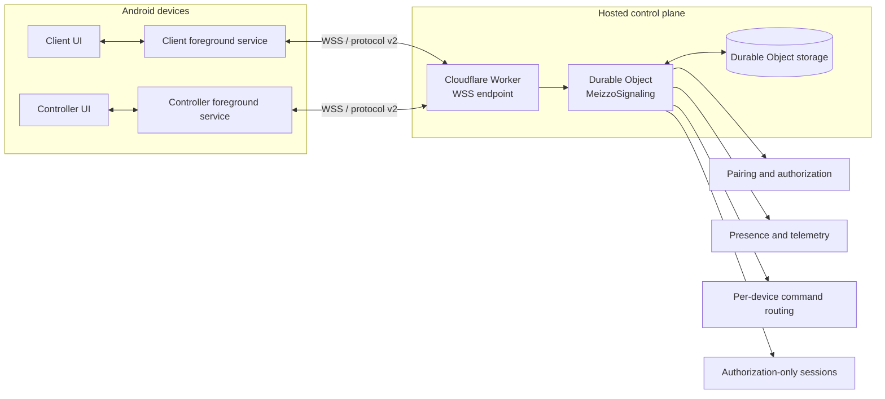

# MEIZZO architecture

**Scope:** architecture shipped in the Android beta and the hosted signaling
implementation. Future media and enterprise components are explicitly marked
as planned.

## 1. System overview

MEIZZO separates the device roles and the control plane:

- **Client:** runs on the device receiving assistance. It owns pairing
  approval, session consent, telemetry collection, and supported local actions.
- **Controller:** runs on the operator device. It manages paired Clients,
  receives presence and telemetry, requests sessions, and sends supported
  commands.
- **Signaling control plane:** authenticates both roles and routes pairing,
  presence, telemetry, session state, and commands.
- **Media plane:** not implemented. A WebSocket connection or approved
  authorization session does not itself provide screen/camera media.

## 2. Android application architecture

Client and Controller are separate Kotlin applications:

| App | Application ID | Responsibilities |
|---|---|---|
| Client | `com.meizzo.client` | Pairing offer, approval UI, telemetry, supported local commands, session decisions |
| Controller | `com.meizzo.controller` | Pairing requests, paired-device list, presence, telemetry, session requests, supported commands |

Each application uses a foreground connection service to own its WebSocket
lifecycle independently of the Activity. The services reconnect with
backoff, restore credentials, and publish state/messages back to the UI.
Boot receivers are present to restore the connection path where Android and
device policy permit it.

This does **not** guarantee an always-on connection. Android force-stop,
battery optimization, OEM autostart policy, revoked permissions, and network
availability can interrupt background execution.

### Local credential storage

Android app credentials are encrypted using AES-GCM with app-specific keys
generated by Android Keystore. The Client and Controller use separate aliases
and separate app sandboxes. Non-secret device metadata is stored separately
from encrypted credentials.

## 3. Signaling service

### Hosted implementation

The deployed endpoint is a Cloudflare Worker configured in root
`wrangler.toml`. The Worker upgrades WebSocket requests and forwards them to
the `MeizzoSignaling` Durable Object. The Durable Object owns the live socket
set and persists its state through Durable Object storage.

Current responsibilities include:

- Protocol hello and capability advertisement (protocol version 2).
- Six-digit pairing offers, expiry, one-time consumption, and rate limiting.
- Client and Controller token authentication.
- Per-Client authorization and multi-Controller relationships.
- Heartbeat, online/offline presence, and telemetry snapshots.
- Device list, rename, revoke, snapshot, and supported command routing.
- Session request, Client approval/rejection, reconnect restoration, and end
  state.

The current Worker uses a single named Durable Object instance for the
signaling namespace. This is a simple beta topology, not a claim of horizontal
sharding or high availability.

### Local development implementation

`services/signaling/src/server.js` is a Node.js + `ws` harness for local
development and automated tests. It uses process-local Maps. Its state is
lost when the process restarts and it must not be confused with the hosted
Durable Object persistence model.

## 4. Pairing and authentication

1. Client registers a six-digit pairing offer with an expiry of up to ten
   minutes.
2. Controller submits the code.
3. Signaling checks the offer, expiry, and attempt limits.
4. Client receives a pairing request and must explicitly approve it.
5. Signaling consumes the offer and issues role-specific random credentials.
6. Both apps authenticate using their own credential.
7. Controller receives the authorized Client list and presence updates.

A pairing code is an invitation, not a permanent credential. The hosted
Worker applies per-Controller and per-IP attempt limits. The current protocol
uses random bearer tokens; server-side token hashing, rotation workflows, and
formal audit trails remain security-hardening work.

## 5. Presence and telemetry

Client sends heartbeat telemetry periodically. The signaling service updates
the Client's last-seen timestamp and broadcasts the state only to Controllers
authorized for that Client. The current Android heartbeat cadence is 15
seconds; the server uses a 45-second heartbeat timeout.

A missing or stale telemetry field must be shown as unavailable, not as zero.
See [device monitoring](device-monitoring.md).

## 6. Session authorization

The protocol supports session types including monitoring, screen, camera,
interaction, and files as authorization labels. The current implementation
supports session lifecycle state:

- Controller requests a session for one authorized Client.
- Client explicitly approves or rejects it.
- Approved session state can be restored after reconnect.
- Controller can end its own session.
- Interaction commands require an approved interaction session.

**Important:** these session types do not mean that the corresponding media
or OS capability is implemented. Screen capture, camera transport, file
transfer, location, and general input injection are not available in the
current beta. An approved session is not a WebRTC connection.

## 7. Update architecture

Android apps query GitHub Releases for their own app asset. The release
pipeline publishes a manifest with package identity, version, file size,
SHA-256, and signing-certificate digest. The updater validates the candidate
before handing installation to Android's Package Installer. It does not
silently install an APK or bypass Android user confirmation.

Client and Controller are separately versioned APKs but currently share the
same release tag and release-signing identity.

## 8. iOS architecture

The repository contains native SwiftUI Client and Controller targets and
shared networking/Keychain code. CI builds and smoke-launches Simulator
targets. Physical-device distribution still requires Apple signing and
provisioning. iOS feature parity and runtime compatibility are not claimed.

## 9. Security boundaries

- WSS is required for the published Android release configuration.
- Pairing requires explicit Client approval.
- Credentials are role- and device-scoped.
- Android credentials use Keystore-backed AES-GCM encryption.
- Sensitive actions require a scoped session approval where implemented.
- The Worker stores device relationships and token records in Durable Object
  state. Server-side token hashing/rotation and audit-event hardening remain
  open work.
- The Node.js harness is in-memory and development-only.

See [security and privacy](security-and-privacy.md) and
[V2 security model](v2/security-model.md).

## 10. Planned architecture, not shipped

The following are future work and must not be represented as current features:

- WebRTC media plane with STUN/TURN.
- MediaProjection screen capture and camera streaming.
- Accessibility-backed interaction with explicit user enablement.
- Scoped file transfer, location sharing, and session audit history.
- Android Enterprise enrollment and managed policy.
- Durable account/device identity, token hashing/rotation, and operational
  security controls.

See the [V2 architecture audit](v2/architecture-audit.md) for gaps and
migration priorities.
