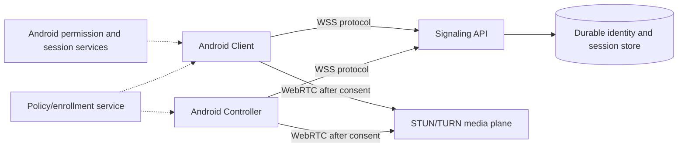

# MEIZZO V2 architecture audit

**Audit basis:** repository `main` at commit `b42ec3a` and the published
`v0.1.0-beta.3` release. This document records observed implementation, not
planned capability.

## Executive assessment

MEIZZO currently has a working beta foundation for consent-based pairing,
token-authenticated WebSocket signaling, presence, telemetry forwarding,
multi-device routing, device commands, Android APK updates, and iOS Simulator
smoke builds. It is not yet a remote-screen or enterprise-management product.
The highest-risk work is the missing media/session architecture, the
monolithic Android UI/lifecycle implementation, and the lack of a hosted
production backend with persistent state and TURN.

## Existing architecture

| Area | Observed implementation | State |
|---|---|---|
| Android apps | Two independent Kotlin Android applications with package IDs `com.meizzo.client` and `com.meizzo.controller` | Working beta |
| Android UI | Programmatic views and lifecycle/network logic concentrated in each `MainActivity` | Working but high refactoring risk |
| Signaling | Node.js `ws` server sharing an HTTP listener with `/healthz` | Working in tests |
| Pairing | Six-digit, expiring, single-use offer; explicit Client approval; rate limiting | Implemented and tested |
| Identity | Random tokens held in Android Keystore-backed stores; server state is in memory | Partial; no durable account/device store |
| Presence | Client heartbeat and authoritative 45-second timeout | Implemented and tested |
| Telemetry | Client-generated snapshot data forwarded in heartbeat metadata | Partial; no schema/version registry |
| Commands | Snapshot, rename, revoke, flashlight/alarm paths | Partial; no remote input or media |
| Updates | GitHub Releases lookup, checksum/package/signature checks, Package Installer handoff | Implemented; physical installation untested |
| iOS | SwiftUI Client/Controller targets and Simulator smoke CI | Simulator beta only |
| CI | Backend, Android debug, documentation, iOS Simulator workflows | Working |

## Broken, incomplete, or absent

- The published beta.3 APKs contain the legacy `ws://10.0.2.2:8080` debug
  endpoint and are unsuitable for BlueStacks Air or production use.
- There is no deployed WSS endpoint, persistent database, account service,
  TURN service, or operational production configuration in this repository.
- WebRTC, MediaProjection screen sharing, camera streaming, Accessibility
  interaction, SAF file transfer, location sharing, and session history are
  not implemented.
- Managed Mode is not implemented. Device Owner/Profile Owner provisioning
  and enterprise policy synchronization are absent.
- Android app state, navigation, permissions, and transport handling are
  coupled in large activities; there is no shared Android domain/data module.
- Backend tokens and paired-device state are process-local and disappear on
  restart. Multi-instance horizontal scaling is therefore unsafe.
- Automated tests cover backend flows, not Android UI, APK installation, or
  physical/BlueStacks runtime behavior.

## Security findings and constraints

Positive controls include explicit Client approval, expiring pairing offers,
pair-attempt rate limiting, per-device authorization checks, token generation
with cryptographic randomness, Keystore storage on Android, WSS enforcement
for release CI, and checksum/signature checks in the updater.

The principal security boundary still missing is durable identity and
revocation. In-memory state means restart behavior and operational recovery
are not production-safe. Sensitive media and remote interaction must not be
added until session-scoped authorization, audit events, consent UI, and
transport encryption are designed together.

## Reusable components

- The current pairing and routing protocol is a useful compatibility base.
- The signaling service's isolated routing tests provide a regression suite for
  Client A/Client B separation.
- Android package IDs, Keystore abstraction, update verification, debug/release
  endpoint split, and CI artifact checks should be preserved.
- iOS targets and simulator workflow should remain a separate future-platform
  track.

## Required refactoring

1. Define versioned protocol contracts and capability negotiation.
2. Move Android transport, identity, telemetry, and session state out of
   activities into testable modules.
3. Introduce a shared Android domain contract without merging the two apps.
4. Add durable backend identity/session storage before deployment or media.
5. Add explicit session lifecycle and audit events before sensitive commands.
6. Add a WebRTC signaling/media boundary only after a real WSS/TURN deployment
   exists.

## Proposed V2 architecture

The signaling API remains the control plane. WebRTC is a separate media plane.
The Client owns OS permission prompts and capture resources; the Controller
requests capabilities but cannot bypass them. Managed Mode is an enrollment
and policy layer, not a privilege escalation.

## Migration risks

- Changing message shapes can strand beta clients; protocol version and
  capability negotiation must be additive first.
- Moving from in-memory tokens to durable storage requires token rotation and
  revocation semantics.
- MediaProjection and Accessibility have OS-controlled consent flows that
  cannot be made silent.
- A new Android UI stack can regress pairing unless backend contract tests and
  debug endpoint injection remain in every CI build.
- Beta.3 signing compatibility is not established; no release should claim
  upgrade support until the historical signing certificate is available.

## Prioritized implementation plan

### P0: foundation and safety

- Version protocol messages and advertise capabilities.
- Define session, capability, telemetry, and error contracts.
- Extract Android transport and identity state from activities.
- Add backend persistence design and deployment contract.
- Keep current pairing/multi-device tests green.

### P1: product shell

- Add a Material 3 design system and state-driven navigation in each app.
- Preserve existing pairing, telemetry, commands, and updater behind the new
  presentation layer.
- Add diagnostics and capability/permission state without inventing support.

### P2: authorized sessions

- Implement session lifecycle and audit events.
- Add MediaProjection foreground service and WebRTC only with a deployed WSS,
  STUN/TURN, and explicit consent flow.
- Evaluate Accessibility as an optional, user-enabled capability with
  protected-UI limitations documented.

### P3: managed and extended capabilities

- Add SAF-based file operations, camera/location consent, and managed
  enrollment only after their platform contracts are implemented.
- Add Android Enterprise provisioning and policy state; do not ship a cosmetic
  Managed Mode toggle.

## Current acceptance boundary

The repository is suitable for continued beta development and automated
signaling regression testing. It is not ready for a production remote-access
release or an enterprise deployment. Physical BlueStacks, physical Android,
signed iOS, hosted backend, TURN, and release-key validation remain external
requirements.
