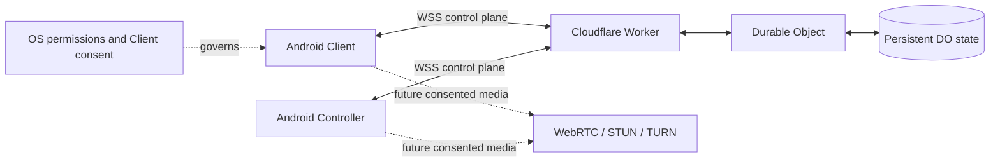

# MEIZZO architecture and security audit

**Audit basis:** beta.5 release workflow run
[42948592178](https://github.com/rakhan17/Meizzo/actions/runs/42948592178),
release source commit `8ddb147c4af628a5166f455c6b58b4d4fbe3dc66`, and the
current hosted Worker implementation.

This is a repository-level engineering audit, not an independent penetration
test, compliance assessment, or security certification.

## Executive assessment

MEIZZO has progressed beyond the original pairing prototype. The Android
beta includes separate Client and Controller apps, authenticated WSS
signaling, explicit pairing and session consent, multi-device routing,
telemetry, supported device commands, foreground connection services,
reconnect handling, secure local credential storage, and a signed release
pipeline. The hosted signaling implementation uses Cloudflare Workers and a
Durable Object for state persistence.

The project is still a beta device-assistance platform. It is not yet a
screen-sharing product, unrestricted remote-control tool, managed enterprise
platform, or formally audited production service.

## Current architecture

| Area | Current implementation | Evidence / boundary |
|---|---|---|
| Android apps | Separate Kotlin Client and Controller apps | Distinct package IDs |
| Android connection lifecycle | Foreground services, reconnect backoff, boot receivers | OEM/OS restrictions still apply |
| Local credentials | AES-GCM values with Android Keystore keys | Per-app aliases |
| Signaling protocol | JSON WebSocket protocol v2 | Worker advertises capability set |
| Hosted signaling | Cloudflare Worker + Durable Object | Durable Object storage persists state |
| Local signaling | Node.js + `ws` | In-memory Maps; development only |
| Pairing | Six-digit, expiring, one-time offer and explicit approval | Rate-limited |
| Authentication | Random role-specific bearer tokens | Server token hardening remains |
| Presence | Heartbeat and offline timeout | 15-second Android cadence, 45-second timeout |
| Multi-device | Per-Client authorization and Controller routing | Automated signaling tests |
| Sessions | Request, approve/reject, restore approved state, end | Authorization metadata only |
| Commands | Snapshot and supported device actions | Interaction command requires approved session |
| Updates | Release manifest, checksum/package/signature checks | Android Package Installer handoff |
| iOS | SwiftUI targets and Simulator CI | No physical-device release |
| Release | Signed Android Client/Controller APKs | beta.5 workflow completed successfully |

## Security strengths

- Pairing code is not reused as the long-term credential.
- Pairing requires explicit Client approval.
- Pairing attempts are rate-limited by Controller and source IP in the Worker.
- Controller authorization is checked against each Client relationship.
- Client and Controller credentials are encrypted locally on Android.
- WSS is required for the published Android release configuration.
- Session approval is distinct from pairing approval.
- Interaction commands require an approved interaction session.
- Release APKs are signed and the pipeline verifies their signatures and
  package/version metadata.

## Important security gaps

- Hosted Durable Object state currently stores authentication token records.
  Server-side token hashing, rotation, revocation audit, and key-management
  operations need further hardening.
- Durable signaling state has not yet been paired with a complete account,
  ownership, recovery, and retention model.
- Formal audit-event retention and operational monitoring are incomplete.
- No independent security review or penetration test is recorded.
- No ISO/IEC 27001, SOC 2, GDPR, or other security certification is claimed.
- The local Node.js harness is process-memory based and must not be deployed as
  if it had the Worker persistence model.
- Foreground services cannot guarantee availability against force-stop,
  OEM battery policies, device shutdown, or network loss.

## Missing product capabilities

- WebRTC media transport and STUN/TURN.
- MediaProjection screen capture and camera streaming.
- General Accessibility-based remote input.
- Scoped file transfer and location sharing.
- Android Enterprise enrollment and Managed Mode.
- Signed iOS physical-device distribution.
- End-to-end acceptance on physical Android devices and multi-instance
  emulator/BlueStacks configurations.

Session type labels for screen, camera, and files are not evidence that those
capabilities exist. The current session implementation is an authorization
lifecycle only.

## Recommended priorities

### P0: security and release integrity

1. Hash server-side tokens at rest and implement token rotation/revocation.
2. Add durable audit events for pairing, authorization, session, and revoke
   transitions without recording secrets.
3. Define data retention and account/device recovery semantics.
4. Perform an independent security review and focused abuse/isolation tests.
5. Add a release provenance check so the published tag points to the exact
   source commit used to build its APK assets.

### P1: runtime acceptance and reliability

1. Complete physical Android testing for Client and Controller.
2. Test two or more Clients with one Controller and verify isolation.
3. Test reconnect, reboot, force-stop, OEM battery restrictions, and network
   interruption.
4. Validate the updater with an existing installation signed by the same key.
5. Add operational health and alerting for the hosted Durable Object.

### P2: sensitive capabilities

1. Design a capability negotiation contract.
2. Add a session-bound MediaProjection flow with explicit consent.
3. Add WebRTC signaling and STUN/TURN only after the security boundary is
   reviewed.
4. Add file, location, and input capabilities individually with platform
   permissions and revocation tests.

### P3: platform and enterprise expansion

1. Complete iOS physical-device signing and testing.
2. Define Android Enterprise enrollment requirements before implementing
   Managed Mode.
3. Avoid claiming platform parity until the same acceptance matrix passes.

## Proposed high-level architecture

The media path is intentionally dashed because it is not implemented.

## Release readiness statement

Beta.5 proves that the Android release pipeline can build, sign, validate,
and publish separate Client and Controller APKs. It does not establish
physical-device compatibility, full remote-control capability, enterprise
readiness, or independent security assurance. Keep those claims separate in
the README, release notes, and product UI.
